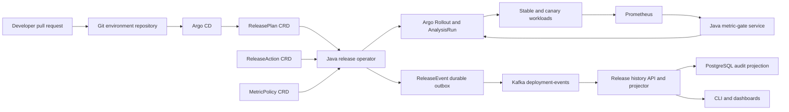

# ReleaseGuard

ReleaseGuard is a planned GitOps progressive-delivery control plane for Kubernetes. It will let developers describe a rollout declaratively, reconcile that desired state through a Java operator, evaluate canaries against Prometheus metrics, and retain an auditable deployment-event history in Kafka.

> **Status:** design and planning. No implementation, performance, reliability, or production-readiness claims are made yet.

## Intended capabilities

- Versioned `ReleasePlan`, `MetricPolicy`, and `ReleaseAction` Kubernetes APIs, plus an internal `ReleaseEvent` outbox.
- A Java 21 operator that performs idempotent reconciliation and safely resumes after restart.
- Git as the desired-state source of truth through Argo CD.
- Staged traffic progression through Argo Rollouts.
- Baseline-aware error-rate and latency gates backed by Prometheus.
- At-least-once Kafka lifecycle events with deterministic IDs and idempotent consumers.
- Docker images, Helm installation, Kind-based local development, and Terraform-managed GKE deployment.
- Reproducible failure drills, control-plane benchmarks, dashboards, runbooks, and postmortems.

## Proposed architecture

The architecture deliberately separates responsibilities:

- Argo CD owns Git-to-cluster synchronization.
- ReleaseGuard owns the developer-facing deployment DSL, policy, orchestration, evidence, and operational API.
- Argo Rollouts owns low-level traffic progression.
- Prometheus supplies observations; the metric-gate service makes policy decisions.
- Kafka is an event transport, not the desired-state database.
- PostgreSQL contains a rebuildable audit projection, not authoritative deployment state.

## Scope discipline

The first release will use Java, Kubernetes, Docker, Helm, Argo CD, Argo Rollouts, Prometheus, Kafka, PostgreSQL, OpenTelemetry, Kind, Terraform, and GKE.

Spinnaker, Cassandra, Redis, AWS/EKS, GraphQL, a custom web UI, and AI-assisted diagnosis are explicitly deferred. Adding overlapping infrastructure before the core control loop is reliable would make the project broader but weaker.

## Plan

The complete design, milestones, test strategy, failure matrix, benchmark protocol, release gates, and evidence rules are in [docs/PROJECT_PLAN.md](docs/PROJECT_PLAN.md).

## License

No open-source license has been selected yet. Until one is added, the repository should not be treated as granting reuse rights.
