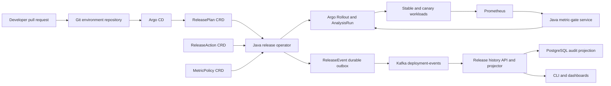

# ReleaseGuard

ReleaseGuard is an implementation-in-progress GitOps progressive-delivery control plane for Kubernetes. Its target workflow lets developers describe a rollout declaratively, reconcile that desired state through a Java operator, evaluate canaries against Prometheus metrics, and retain an auditable deployment-event history in Kafka.

> **Status:** Week 1 contracts and two Week 2 control-loop slices are implemented. General rollout progression, metric-driven decisions, child-event sources, external integrations, deployment packaging, and operational measurements are not implemented yet. No production-readiness claim is made.

## Implemented

- A pinned Java 21 and Gradle 9.7.1 six-module build.
- Fabric8 models for the namespaced `ReleasePlan`, `ReleaseAction`, and `ReleaseEvent` APIs and cluster-scoped `MetricPolicy` API.
- Deterministic semantic validation for image digests, rollout steps, bootstrap gates, approved metric thresholds, pod security, active-release updates, actions, and outbox identity.
- Reproducible structural CRDs with status subresources and printer columns.
- A Java Operator SDK reconciler that records generation-scoped validation before applying child resources and refuses to publish progress status when an apply fails.
- Deterministic server-side-apply rendering for stable/canary Services, ingress-nginx Ingress, and Argo Rollout resources with owner references and operator-owned selectors.
- Fail-closed indefinite Argo pauses until metric-gate integration exists, plus a lightweight Kubernetes API-server test proving repeated apply does not duplicate resources.
- A bounded cleanup finalizer that requests Argo abort, verifies controller acknowledgment, stable ready endpoints, and zero canary ingress weight, then deletes children or detaches stable resources according to policy.
- Eight-attempt exponential retry for reconciliation and configurable cleanup timing through `RELEASEGUARD_CLEANUP_DEADLINE` (default `60s`) and `RELEASEGUARD_CLEANUP_REQUEUE_INTERVAL` (default `1s`).
- A checksum-pinned Kind test that stops the real Argo Rollouts controller during deletion, proves the finalizer remains held, restarts Argo, captures traffic weight restoration from 5% to 0%, and verifies managed-child deletion.
- JUnit and jqwik contract tests, formatting checks, CRD freshness verification, wrapper validation, and dependency review.

## Build and verify

Install JDK 21, then run:

```bash
./gradlew clean check
```

When an API model changes, deliberately refresh and review the committed schemas:

```bash
./gradlew :api-model:syncCrds
git diff -- config/crd
```

Run the live Argo finalizer scenario with Docker and `kubectl` available:

```bash
./scripts/install-kind.sh
./tests/e2e/kind-finalizer.sh
```

This test runs the real Argo Rollouts controller but not ingress-nginx, so it verifies controller state and generated Ingress weights rather than network traffic.

Example resources are under [`config/examples`](config/examples), generated CRDs under [`config/crd`](config/crd), and accepted architecture decisions under [`docs/adr`](docs/adr).

## Intended capabilities

- Versioned `ReleasePlan`, `MetricPolicy`, and `ReleaseAction` Kubernetes APIs, plus an internal `ReleaseEvent` outbox.
- A Java 21 operator that performs idempotent reconciliation and safely resumes after restart.
- Git as the desired-state source of truth through Argo CD.
- Staged traffic progression through Argo Rollouts.
- Baseline-aware error-rate and latency gates backed by Prometheus.
- At-least-once Kafka lifecycle events with deterministic IDs and idempotent consumers.
- Docker images, Helm installation, Kind-based local development, and Terraform-managed GKE deployment.
- Reproducible failure drills, control-plane benchmarks, dashboards, runbooks, and postmortems.

## Target architecture



The architecture deliberately separates responsibilities:

- Argo CD owns Git-to-cluster synchronization.
- ReleaseGuard owns the developer-facing deployment DSL, policy, orchestration, evidence, and operational API.
- Argo Rollouts owns low-level traffic progression.
- Prometheus supplies observations; the metric-gate service makes policy decisions.
- Kafka is an event transport, not the desired-state database.
- PostgreSQL contains a rebuildable audit projection, not authoritative deployment state.

## Scope discipline

The first release will use Java, Kubernetes, Docker, Helm, Argo CD, Argo Rollouts, Prometheus, Kafka, PostgreSQL, OpenTelemetry, Kind, Terraform, and GKE.

Spinnaker, Cassandra, Redis, AWS/EKS, GraphQL, a custom web UI, and AI-assisted diagnosis are explicitly deferred. Adding overlapping infrastructure before the core control loop is reliable would make the project broader but weaker.

## Specification and plan

- [spec.md](spec.md) is the normative v1 contract: APIs, ownership, reconciliation, gate decisions, failure semantics, security, and acceptance scenarios.
- [docs/PROJECT_PLAN.md](docs/PROJECT_PLAN.md) defines the implementation roadmap, benchmarks, release gates, and evidence rules.

## License

No open-source license has been selected yet. Until one is added, the repository should not be treated as granting reuse rights.
