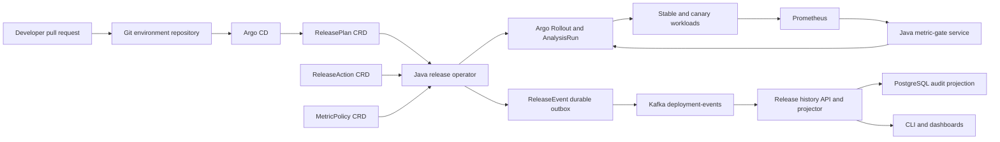

# ReleaseGuard

ReleaseGuard is an implementation-in-progress GitOps progressive-delivery control plane for Kubernetes. Its target workflow lets developers describe a rollout declaratively, reconcile that desired state through a Java operator, evaluate canaries against Prometheus metrics, and retain an auditable deployment-event history in Kafka.

> **Status:** Weeks 1-5 and active-passive operator leader election are implemented, including the metric-gate service, gated Argo resources, durable Kafka outbox, PostgreSQL history API, and authenticated operational actions. A live metric-driven rollout against real canary traffic, automated failure drills, complete observability, GKE operation, and scale/soak benchmarks remain outstanding. No production-readiness claim is made.

## Implemented

- A pinned Java 21 and Gradle 9.7.1 six-module build.
- Fabric8 models for the namespaced `ReleasePlan`, `ReleaseAction`, and `ReleaseEvent` APIs and cluster-scoped `MetricPolicy` API.
- Deterministic semantic validation for image digests, rollout steps, bootstrap gates, approved metric thresholds, pod security, active-release updates, actions, and outbox identity.
- A distributable `releaseguard` CLI for fail-closed, cluster-free plan validation and deterministic YAML/JSON rendering through the operator's production renderer, including explicit or sibling policy resolution and nonzero failure status.
- A Spring Boot metric-gate API that evaluates separate stable/canary value and sample-count queries, applies direction-aware absolute and baseline thresholds, and returns deterministic `Pass`, `Fail`, or `Inconclusive` decisions with canonical SHA-256 evidence digests.
- A bounded Prometheus HTTP client that classifies empty, multiple-series, partial, malformed, non-finite, stale, timed-out, and failed observations without translating missing monitoring into success.
- Purpose-built fake-Prometheus integration tests, an administrator-bounded p95-latency policy, Actuator health probes, Prometheus-format service metrics, bearer-token authentication, and graceful shutdown.
- Reproducible structural CRDs with status subresources and printer columns.
- A Java Operator SDK reconciler that records generation-scoped validation before applying child resources and refuses to publish progress status when an apply fails.
- Deterministic server-side-apply rendering for stable/canary Services, ingress-nginx Ingress, generation-scoped Argo AnalysisTemplates, and Argo Rollouts with owner references and generation-stable workload selectors.
- Authenticated AnalysisTemplates that snapshot accepted MetricPolicy specifications and resource versions, map gate limits to Argo v1.9.1 semantics, resolve bearer tokens from same-namespace Secrets, and omit caller timestamps so the gate assigns evaluation time.
- Java Operator SDK informer sources for managed Rollout, Service, and Ingress changes, with generation-current projection of Argo phase, logical step, stable hash, and canary hash into `ReleasePlan` status.
- Resource-versioned primary status updates with full-reconciliation conflict recovery; a kube-apiserver integration test injects a real `409 Conflict`, verifies a fresh resource version, preserves the concurrent phase and revisions, and converges to the same five child resources.
- An explicit field-ownership handoff: ReleaseGuard initializes Service identity selectors, then omits the selector after Argo installs its pod-template hash while continuing to verify traffic state.
- Gate-driven canary steps: every nonterminal step renders `setWeight` followed by a blocking `analysis` step that names the release generation's AnalysisTemplate and passes the step index, canary mode, and Argo stable/latest pod-template hashes, while weight 100 stays a bare promotion step reachable only through the preceding gates.
- A checked observation budget: each metric delays its first measurement by one policy window, bounds measurement count by the step duration to satisfy Argo Rollouts inline analysis validation while preserving streak-based promotion, bounds consecutive transport errors, and runs under a progress deadline derived from the longest declared step; plans whose step duration cannot contain `window + (max(failureLimit, consecutiveSuccesses, inconclusiveLimit) - 1) x interval` are rejected as `RG-ROLL-004` errors.
- Status projection of Argo outcomes into `Succeeded`, `Paused` on an inconclusive-analysis pause condition, and `RollingBack` followed by `RolledBack` only after observed zero canary ingress weight and ready stable endpoints, with the AnalysisRun name and verdict recorded as `status.lastGateDecision` and surfaced through the `GateHealthy` condition.
- Gated bootstrap admission: Argo skips canary steps for a first generation, so the operator creates its own generation-scoped `AnalysisRun` in `Bootstrap` mode from the absolute-threshold gates, only after the stable Service has ready endpoints behind the promoted revision. A passed gate records the first stable revision, a breached threshold fails the release and scales the candidate to zero without claiming rollback, and inconclusive or unavailable evidence leaves it unadmitted and degraded.
- An informer that maps ReleaseGuard-owned analysis runs back to their plan, and finalization that removes both ReleaseGuard-owned and Rollout-owned analysis children, including on `OrphanStable` where the Rollout is deleted without cascading.
- A lightweight Kubernetes API-server test proving repeated apply does not duplicate resources.
- A bounded cleanup finalizer that requests Argo abort, verifies controller acknowledgment, stable ready endpoints, and zero canary ingress weight, then either deletes every child or conflict-resiliently retains a controller-independent stable ReplicaSet, Service, and Ingress.
- Eight-attempt exponential retry for reconciliation and configurable cleanup timing through `RELEASEGUARD_CLEANUP_DEADLINE` (default `60s`) and `RELEASEGUARD_CLEANUP_REQUEUE_INTERVAL` (default `1s`).
- A digest-pinned multi-stage operator image with an Eclipse Temurin 21 builder and Distroless Java 21 non-root runtime; automated checks enforce UID/GID 65532, a shell-free runtime, no source/build tree, and no more than 50 MiB above the architecture-specific runtime base.
- A separately verified metric-gate image with the same pinned, non-root Distroless boundary and a Helm-managed `ClusterIP` Deployment that reads its token from an existing Kubernetes Secret without rendering credential material.
- Separate `/healthz` and `/readyz` endpoints: liveness starts with the process, while readiness is withheld until Java Operator SDK startup completes.
- A Helm 4 chart with all four generated CRDs, explicit cluster-wide least-privilege RBAC, immutable-digest rendering, Recreate upgrades, resource limits, and Kubernetes Restricted-profile container settings.
- A clean Kind installation test that loads both verified images, installs the chart with ephemeral Secrets, observes operator and metric-gate probes, verifies the gate's authentication boundary, denies the operator access to Secrets and Namespace deletion, reconciles a `ReleasePlan` into an Argo Rollout and AnalysisTemplate, and executes the template as a real AnalysisRun.
- One local arm64 run against Kubernetes v1.35.0 and Argo Rollouts v1.9.1 resolved the token from a same-namespace Secret, preserved the snapshotted policy resource version, and classified missing Prometheus evidence as `Inconclusive`; this is integration evidence, not a production SLO.
- A checksum-pinned Argo CD v3.5.2 installer, automated-sync Application, and committed `environments/local` desired-state path with pruning, retry, and self-healing enabled.
- A self-contained Kind GitOps test that serves a disposable non-root Git remote, observes a second commit synchronize without an imperative deployment command, and verifies Argo CD restores unauthorized live drift. One local arm64 run observed 4-second Git synchronization and 3-second drift recovery; these are test observations, not production SLOs.
- A checksum-pinned Kind test that exercises multi-generation status observation and both deletion policies against Argo Rollouts v1.9.1 and Kubernetes v1.35.0: it observes a real gated canary step holding 5% traffic as logical step 0, proves `Delete` holds its finalizer through an Argo outage, and proves `OrphanStable` remains ready without recreating canary resources after both controllers restart.
- A durable `ReleaseEvent` outbox and idempotent Kafka publisher, plus a Spring Boot history API that projects versioned events transactionally into PostgreSQL, deduplicates event IDs, exposes freshness and gate evidence, and rebuilds its release view from retained events.
- RSA-verified OIDC bearer authentication for operational actions, with subject-derived actor identity and role plus namespace/application scope authorization. Caller-controlled identity headers, invalid signatures, viewer mutations, and out-of-scope operator mutations are rejected.
- An offset-keyed PostgreSQL poison-record quarantine that commits malformed envelopes without blocking later partition records while leaving valid records uncommitted when PostgreSQL projection fails. A Testcontainers test exercises the operator-produced envelope through real Kafka and PostgreSQL, poison recovery, and the database-failure retry boundary.
- JUnit and jqwik contract tests, formatting checks, CRD freshness verification, wrapper validation, and dependency review.

## Build and verify

Install JDK 21, then run:

```bash
./gradlew clean check
```

When an API model changes, deliberately refresh and review the committed schemas:

```bash
./gradlew :api-model:syncCrds
git diff -- config/crd
```

Run the live Argo finalizer scenario with Docker and `kubectl` available:

```bash
./scripts/install-kind.sh
./tests/e2e/kind-finalizer.sh
```

This test runs the real Argo Rollouts controller but neither ingress-nginx nor Prometheus, so it verifies control-plane state, ready endpoints, and generated Ingress weights rather than request routing or metric-driven progression.
The test deploys no metric-gate service, so the generated bootstrap AnalysisRun cannot reach a verdict; it asserts that the run exists in `Bootstrap` mode with no baseline, then explicitly patches the bootstrap phase to `Succeeded` before creating its second `ReleasePlan` generation. It does not claim automated promotion.
Every release namespace needs the metric-gate token Secret before a canary step runs: Argo resolves that reference when it starts an AnalysisRun, and a missing Secret fails the run closed rather than promoting.

Build and run the offline CLI:

```bash
./gradlew :cli:installDist
./cli/build/install/releaseguard/bin/releaseguard plan validate \
  -f config/examples/releaseplan-checkout.yaml
./cli/build/install/releaseguard/bin/releaseguard plan render \
  -f config/examples/releaseplan-checkout.yaml -o json
```

The CLI automatically discovers `MetricPolicy` YAML beside the plan; use repeated `-p` flags for policies elsewhere. Git-authored plans do not have Kubernetes UIDs, so offline rendering derives a deterministic preview UID and warns before the output is applied. Pass `--uid` and `--generation` to render against an exact live identity. Neither command contacts or mutates a cluster.

Run the metric-gate service against a Prometheus-compatible endpoint:

```bash
RELEASEGUARD_GATE_AUTH_TOKEN="$(openssl rand -hex 32)" \
PROMETHEUS_BASE_URL=http://127.0.0.1:9090 \
  ./gradlew :metric-gate-service:run
```

The internal API is `POST /internal/v1/evaluations`; health and metrics are exposed at `/actuator/health` and `/actuator/prometheus`. See [`docs/METRIC_GATES.md`](docs/METRIC_GATES.md) for the request contract, decision table, reason codes, and current security/deployment boundary.

Build and inspect the runtime image, verify the chart, and reproduce the clean-cluster install:

```bash
RELEASEGUARD_OPERATOR_IMAGE=releaseguard-operator:dev ./tests/container/operator-image.sh
RELEASEGUARD_GATE_IMAGE=releaseguard-metric-gate:dev ./tests/container/metric-gate-image.sh
./scripts/install-helm.sh
./tests/helm/chart.sh
./scripts/install-kind.sh
./tests/e2e/kind-helm-install.sh
./tests/e2e/kind-gitops.sh
```

On Docker Desktop 28.4.0 for `linux/arm64`, the operator image measured 86,672,799 bytes with 24,131,372 application-layer bytes; the metric-gate image measured 99,798,482 bytes with 37,257,055 application-layer bytes. These are packaging observations, not performance benchmarks. Active-passive operator leader election is supported via Kubernetes Lease coordination (ADR 0009, RG-REC-007, RG-REC-008) with zero-downtime `RollingUpdate` upgrades across multiple replicas.

Example resources are under [`config/examples`](config/examples), the Git-authored local environment under [`environments/local`](environments/local), and accepted architecture decisions under [`docs/adr`](docs/adr). See [`docs/GITOPS.md`](docs/GITOPS.md) for the ownership model and test procedure.

## Intended capabilities

- Versioned `ReleasePlan`, `MetricPolicy`, and `ReleaseAction` Kubernetes APIs, plus an internal `ReleaseEvent` outbox.
- A Java 21 operator that performs idempotent reconciliation and safely resumes after restart.
- Staged traffic progression through Argo Rollouts.
- Baseline-aware error-rate and latency gates backed by Prometheus.
- At-least-once Kafka lifecycle events with deterministic IDs and idempotent consumers.
- Terraform-managed GKE deployment.
- Reproducible failure drills, control-plane benchmarks, dashboards, runbooks, and postmortems.

## Target architecture



The architecture deliberately separates responsibilities:

- Argo CD owns Git-to-cluster synchronization.
- ReleaseGuard owns the developer-facing deployment DSL, policy, orchestration, evidence, and operational API.
- Argo Rollouts owns low-level traffic progression.
- Prometheus supplies observations; the metric-gate service makes policy decisions.
- Kafka is an event transport, not the desired-state database.
- PostgreSQL contains a rebuildable audit projection, not authoritative deployment state.

## Scope discipline

The first release will use Java, Kubernetes, Docker, Helm, Argo CD, Argo Rollouts, Prometheus, Kafka, PostgreSQL, OpenTelemetry, Kind, Terraform, and GKE.

Spinnaker, Cassandra, Redis, AWS/EKS, GraphQL, a custom web UI, and AI-assisted diagnosis are explicitly deferred. Adding overlapping infrastructure before the core control loop is reliable would make the project broader but weaker.

## Specification and plan

- [spec.md](spec.md) is the normative v1 contract: APIs, ownership, reconciliation, gate decisions, failure semantics, security, and acceptance scenarios.
- [docs/PROJECT_PLAN.md](docs/PROJECT_PLAN.md) defines the implementation roadmap, benchmarks, release gates, and evidence rules.

## License

No open-source license has been selected yet. Until one is added, the repository should not be treated as granting reuse rights.
