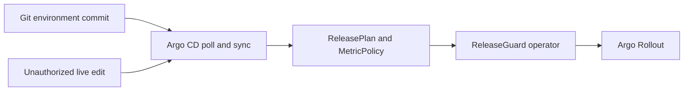

# GitOps development path

ReleaseGuard uses Git for desired deployment state, Argo CD for Git-to-cluster synchronization, ReleaseGuard for release-policy reconciliation, and Argo Rollouts for workload progression. These responsibilities must not be conflated.



## Committed configuration

- `environments/local/` contains the Namespace, cluster-scoped `MetricPolicy`, and namespaced `ReleasePlan`.
- `config/argocd/releaseguard-local.yaml` tracks that directory from `main` with automated synchronization, pruning, retry, and self-healing.
- The Application does not install ReleaseGuard or Argo Rollouts. Platform installation remains separate from application desired state.

For a real environment, fork the Application manifest, change `repoURL`, `targetRevision`, path, and destination namespace, and review the policy centrally before merging. Do not commit repository credentials.

## Reproduce the proof

```bash
RELEASEGUARD_OPERATOR_IMAGE=releaseguard-operator:dev \
  ./tests/container/operator-image.sh
./scripts/install-helm.sh
./scripts/install-kind.sh
./tests/e2e/kind-gitops.sh
```

The test creates a fresh Kind cluster, installs the verified chart plus Argo Rollouts, installs checksum-pinned Argo CD, and serves a disposable repository through a non-root Git daemon. It asserts:

1. The initial commit becomes `Synced` and produces a real Rollout.
2. A second Git commit changes a Git-owned `ReleasePlan` label and reaches the cluster without any deployment or refresh command.
3. An unauthorized live label is restored to the Git value by Argo CD self-healing.

Raw evidence is written beneath ignored `build/e2e/`. Five-second poll and cache intervals make the test deterministic; production intervals require capacity-based tuning. This test does not prove GitHub availability, production recovery latency, traffic routing, or automated canary promotion.
