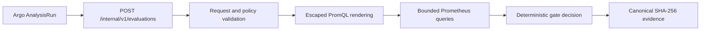

# Metric-Gate Service

## Current boundary

The metric-gate service implements the stateless portions of `RG-GATE-001` through `RG-GATE-011`. Generated Rollouts now call the generated AnalysisTemplate on every nonterminal canary step, so Argo Rollouts owns traffic changes, total failure limits, consecutive-success limits, inconclusive limits, and AnalysisRun lifecycle. The gate owns one decision at a time and holds no state between measurements.



## Evaluation contract

A request snapshots the release ID, step, mode, policy specification and resource version, stable/canary revisions, and thresholds. `evaluationTime` is optional: the gate assigns UTC server time before validation and evidence hashing when Argo omits it. `Bootstrap` forbids a stable revision and requires an absolute threshold. `Canary` requires different stable and canary revisions.

Each revision uses separate value and sample-count PromQL queries. Substitutions for revision, namespace, and release name must occur inside string literals and are escaped; the validated duration window must remain outside quotes. The service applies both the policy timeout and the smaller remaining overall request deadline.

| Evidence | Decision | Representative reason |
|---|---|---|
| Enough samples and all configured predicates pass | `Pass` | `WithinAbsoluteAndBaselineLimits` |
| Complete evidence breaches an absolute or baseline threshold | `Fail` | `AbsoluteThresholdBreached` |
| Evidence is unsafe or unavailable | `Inconclusive` | `EmptyVector`, `StaleObservation`, `ProviderTimeout` |

`Inconclusive` is never success and does not independently request rollback. Reaching the AnalysisRun inconclusive limit pauses progression when monitoring is unavailable.

MetricPolicy query templates use ReleaseGuard placeholders such as `{{revision}}` and `{{window}}`, while Argo uses `{{ args.* }}`. The renderer wraps the policy placeholders in default Argo arguments so Argo's single substitution pass restores the original PromQL template instead of rejecting it as an unresolved analysis argument.

## Rollout linkage

Each nonterminal step renders as `setWeight` followed by an inline `analysis` step that names the generation's template and supplies `step`, `mode=Canary`, and the Argo stable and latest pod-template hashes as revision identities. Application telemetry or Prometheus relabeling must expose that hash under the label the policy query uses. Weight 100 renders as a bare `setWeight`, so terminal promotion is reachable only through every preceding gate.

| Argo AnalysisRun outcome | Rollout effect | `ReleasePlan` phase |
|---|---|---|
| `Successful` (consecutive-success limit reached) | Advance to the next step | `Progressing`, then `Succeeded` after the terminal step |
| `Failed` (total failure limit reached) | Abort and restore stable | `RollingBack`, then `RolledBack` |
| `Inconclusive` (total inconclusive limit reached) | Pause | `Paused` |
| `Error` (consecutive transport errors) | Abort and restore stable | `RollingBack`, then `RolledBack` |

`RolledBack` requires observed traffic, not an accepted abort: zero canary ingress weight plus ready stable endpoints (RG-RBK-002). The AnalysisRun name and verdict are recorded in `status.lastGateDecision` and reflected in the `GateHealthy` condition.

Each metric delays its first measurement by one policy window, because a measurement taken immediately after a traffic shift reads samples that predate the candidate. A step duration must therefore be at least `window + (max(failureLimit, consecutiveSuccesses, inconclusiveLimit) - 1) x interval`; shorter combinations are rejected as `RG-ROLL-004` plan errors. Argo's `count` is deliberately not rendered: an exhausted measurement count is assessed `Successful`, and this control plane promotes only on an explicit consecutive-success streak.

Argo resolves the template's token argument from the same-namespace Secret when it starts a run, so a release namespace without that Secret fails the run closed and aborts the candidate instead of promoting it.

## Run and verify

```bash
RELEASEGUARD_GATE_AUTH_TOKEN="$(openssl rand -hex 32)" \
PROMETHEUS_BASE_URL=http://127.0.0.1:9090 \
  ./gradlew :metric-gate-service:run

./gradlew :metric-gate-service:test
curl --fail http://127.0.0.1:8080/actuator/health
```

The default overall deadline is 10 seconds and can be changed with `GATE_REQUEST_TIMEOUT` up to one minute. `POST /internal/v1/evaluations` requires `Authorization: Bearer <token>`; missing and invalid credentials receive the same `401` response. Tokens must contain at least 32 UTF-8 bytes and are redacted from configuration rendering. Health and metrics remain unauthenticated for Kubernetes probes and cluster-local Prometheus scraping.

The Helm chart deploys the service behind a `ClusterIP`, disables service-account-token mounting, and reads the bearer token through a reference to `metricGate.auth.existingSecret`. It never creates the Secret or embeds the token in a Deployment. Generated AnalysisTemplates independently reference `operator.analysis.auth.existingSecret`; an external Secret controller or platform administrator must provision that Secret and key in every ReleasePlan namespace. ReleaseGuard deliberately has no Secret-read permission. `/actuator/prometheus` exposes query latency/outcomes, gate decisions/reasons, JVM, process, and HTTP server metrics without release IDs or revisions as labels.

The current Kind profile does not terminate TLS or install a NetworkPolicy, so the bearer token travels over the cluster network. That is acceptable only for the documented disposable local environment. A cloud deployment must add mesh or service TLS and namespace-scoped network policy before this boundary can be called production-safe.

## Evidence integrity

The response digest is SHA-256 over canonical JSON containing the complete request snapshot, rendered query metadata, normalized observations, decision, reason, and query window. The same request and observations therefore produce the same digest. Provider bodies, credentials, and authorization headers are never included in responses or logs.
