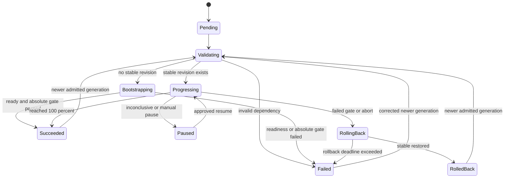

# ReleaseGuard project plan

The normative v1 API and behavior contract is [spec.md](../spec.md). This document defines sequencing, evidence, and release execution.

## 1. Project thesis

ReleaseGuard will be a Kubernetes-native progressive-delivery control plane that turns a constrained deployment DSL into auditable, metric-gated rollouts.

The project is successful only if it demonstrates software-engineering depth:

- clear API and state-machine design;
- idempotent distributed control loops;
- safe behavior under dependency and process failure;
- useful integration with existing cloud-native systems;
- measurable control-plane and recovery behavior;
- repeatable deployment and operation;
- honest separation between implemented logic and integrated third-party capabilities.

Installing Argo CD, Kafka, and Grafana is not sufficient. ReleaseGuard must own meaningful orchestration and reliability behavior.

## 2. Status and evidence policy

Current status: **Week 3 complete; Week 4 metric gates drive canary steps and bootstrap admission, live gated-rollout evidence outstanding**.

The Java 21 multi-module build, four API models, semantic validators, deterministic CRD generation, architecture decisions, contract tests, Week 2 operator control loop, hardened operator and metric-gate images, Helm installation path, Argo CD Git synchronization, offline plan CLI, authenticated stateless metric-gate service, generation-scoped AnalysisTemplate rendering, gate-driven canary steps with promotion, pause, and rollback projection, and gated bootstrap admission are implemented. A live gated rollout against real canary traffic and a running Prometheus server has not been executed, and rollback deadlines, operator actions, and the durable event outbox remain planned. Numbers marked as targets are acceptance criteria, not benchmark results or resume claims.

Evidence rules:

1. Never describe the project as production or high scale solely because it runs on Kubernetes or GKE.
2. Label Kind results as local or CI measurements and GKE results as cloud experiments.
3. Record exact hardware, cluster shape, software versions, workload, duration, and commands for every result.
4. Commit raw machine-readable benchmark output alongside summarized charts.
5. Preserve failed experiments and publish at least one postmortem.
6. Attribute Argo CD reconciliation, Argo Rollouts traffic management, Prometheus collection, and Kafka transport to those systems. Claim only the DSL, operator, gate logic, APIs, event contracts, tests, and tooling implemented here.

## 3. Users and primary workflow

### Primary user

A service developer who wants a paved path from an immutable image to a staged Kubernetes rollout without hand-authoring Argo resources or PromQL.

### Platform administrator

Defines approved metric policies, cluster-wide rollout constraints, RBAC, and operational defaults.

### Operator or responder

Inspects status and evidence, pauses or aborts unsafe rollouts, and follows documented recovery procedures.

### Golden path

1. CI builds, tests, scans, and publishes an immutable image.
2. A pull request changes a `ReleasePlan` image digest in the environment directory.
3. Review and merge make Git the desired-state record.
4. Argo CD synchronizes the `ReleasePlan` into the cluster.
5. ReleaseGuard validates the plan and referenced policies.
6. The operator renders Argo Rollout and Analysis resources.
7. Argo Rollouts shifts traffic through declared stages.
8. The metric-gate service compares canary and stable signals.
9. The rollout advances, pauses, or rolls back according to explicit policy.
10. Deterministic lifecycle events are persisted as internal `ReleaseEvent` resources, published to Kafka, and projected into the audit API.

## 4. Goals

### Functional goals

- Provide a versioned, declarative release API.
- Validate rollout plans before they affect workloads.
- Reconcile safely and idempotently after duplicate events or controller restarts.
- Support automatic canary promotion, pause, and rollback.
- Compare canary metrics with both absolute SLO limits and stable-version baselines.
- Preserve a queryable, replayable deployment history.
- Provide REST endpoints and a CLI for validation, status, evidence, pause, promote, and abort workflows.
- Install reproducibly on a clean Kind cluster and an ephemeral GKE cluster.

### Engineering goals

- Make failure semantics explicit rather than relying on happy-path demos.
- Keep desired state, observed state, and derived audit state separate.
- Use at-least-once event delivery with idempotent processing instead of pretending to have cross-system exactly-once transactions.
- Expose saturation, queueing, reconciliation, decision, and recovery metrics.
- Produce a repository another engineer can run, test, and critique.

## 5. Non-goals for v1

- Replacing Argo CD or Argo Rollouts.
- General-purpose CI execution or build scheduling.
- Multi-cloud parity.
- Multi-region active-active control planes.
- A proprietary service mesh or traffic router.
- Arbitrary user-provided PromQL execution.
- A custom React dashboard.
- LLM-generated root-cause analysis.
- Spinnaker integration.
- Cassandra or Redis without a demonstrated data or caching requirement.
- A claim of production adoption without real external users and operations.

## 6. Planned technology choices

| Area | Choice | Reason |
|---|---|---|
| Language | Java 21 | Demonstrates modern Java and aligns with platform-service roles |
| Build | Gradle Kotlin DSL | Multi-module builds, test fixtures, reproducible wrapper |
| Service framework | Spring Boot | REST, configuration, health, metrics, graceful shutdown |
| Kubernetes client | Java Operator SDK and Fabric8 | Reconciliation framework, CRD support, Kubernetes API integration |
| Desired-state sync | Argo CD | GitOps source-of-truth and drift correction |
| Progressive delivery | Argo Rollouts | Staged traffic and AnalysisRun lifecycle |
| Metrics | Prometheus and Micrometer | Gate inputs and control-plane instrumentation |
| Dashboards | Grafana | Operational visualization without building a bespoke UI |
| Event transport | Apache Kafka | Ordered per-release lifecycle events and replay |
| Audit projection | PostgreSQL | Queryable, rebuildable read model with idempotency constraints |
| Tracing | OpenTelemetry | Cross-component correlation |
| Local/CI cluster | Kind | Cheap, deterministic, reviewer-friendly Kubernetes environment |
| Packaging | Docker and Helm | Reproducible images and cluster installation |
| Cloud | GKE provisioned by Terraform | One complete cloud path rather than shallow multi-cloud support |
| Load generation | k6 plus purpose-built Java harnesses | Request load and control-plane/event benchmarks |

Versions will be pinned during implementation and updated through automated dependency pull requests. Version numbers are intentionally absent from the plan until the bootstrap milestone verifies compatibility.

## 7. Repository structure

```text
releaseguard/
├── api-model/                 # Shared API types and validation rules
├── release-operator/          # Kubernetes reconcilers and resource rendering
├── metric-gate-service/       # Prometheus queries and gate decisions
├── release-history-api/       # Kafka consumer, PostgreSQL projection, REST API
├── cli/                       # Developer and operator commands
├── demo-service/              # Instrumented stable/canary workload
├── charts/
│   └── releaseguard/          # Platform Helm chart
├── config/
│   ├── crd/                   # Generated and reviewed CRDs
│   ├── argocd/                # Argo CD applications
│   ├── policies/              # Example administrator MetricPolicies
│   └── examples/              # Example ReleasePlans and actions
├── deploy/
│   ├── kind/                  # Local cluster bootstrap
│   └── gke/                   # Cloud overlays
├── terraform/
│   └── gke/                   # Ephemeral GKE infrastructure
├── tests/
│   ├── integration/
│   ├── e2e/
│   ├── failure/
│   └── load/
├── docs/
│   ├── adr/
│   ├── architecture/
│   ├── evidence/
│   ├── postmortems/
│   └── runbooks/
└── scripts/                   # Portable orchestration scripts used by Make targets
```

Generated CRDs, the Gradle wrapper, Terraform lock files, Helm lock files, and reproducible summarized evidence belong in Git. Credentials, Terraform state, local cluster data, IDE configuration, raw local profiles, and unreviewed benchmark output do not.

## 8. API design

### 8.1 ReleasePlan

`ReleasePlan` is the long-lived developer-facing desired state for one application in one namespace. Updating its pod template creates a new release generation.

```yaml
apiVersion: delivery.weihantu.dev/v1alpha1
kind: ReleasePlan
metadata:
  name: checkout
  namespace: demo
spec:
  workload:
    replicas: 10
    managedContainer: app
    podTemplate:
      metadata:
        labels:
          app.kubernetes.io/name: checkout
      spec:
        containers:
          - name: app
            image: ghcr.io/weihantu/checkout@sha256:0123456789abcdef0123456789abcdef0123456789abcdef0123456789abcdef
            ports:
              - name: http
                containerPort: 8080
  network:
    servicePort: 80
    targetPort: http
    ingress:
      className: nginx
      host: checkout.releaseguard.local
      path: /
  rollout:
    steps:
      - weight: 5
        duration: 5m
      - weight: 25
        duration: 5m
      - weight: 50
        duration: 5m
      - weight: 100
  gates:
    - policyRef: http-errors
      maxCanaryValue: 0.01
      maxDeltaFromStable: 0.005
      failureLimit: 3
      consecutiveSuccesses: 2
      inconclusiveLimit: 3
    - policyRef: request-p95
      maxCanaryValue: 250
      failureLimit: 3
      consecutiveSuccesses: 2
      inconclusiveLimit: 3
  failurePolicy:
    metricUnavailable: Pause
    gateFailed: Rollback
    rollbackDeadline: 60s
```

Important constraints:

- Images must use digests in release environments.
- Weights must be monotonically increasing and end at 100.
- Durations and thresholds have administrator-defined bounds.
- A developer references an approved metric policy and cannot inject arbitrary PromQL.
- Every spec update increments Kubernetes generation; the controller records `observedGeneration`.

### 8.2 MetricPolicy

`MetricPolicy` is administrator-controlled and maps a logical metric to safe Prometheus query templates and comparison rules.

Examples:

- HTTP 5xx ratio by stable/canary revision;
- p95 request latency by revision;
- saturation or queue-depth limit;
- minimum request-sample requirement.

Policy behavior must define:

- query and evaluation window;
- minimum samples;
- absolute threshold;
- optional delta from stable;
- consecutive-success, total-failure, and inconclusive limits;
- NaN, empty, stale, timeout, and provider-error handling.

### 8.3 ReleaseAction

Operational commands must not silently overwrite Git-managed desired state. The API creates short-lived, audited `ReleaseAction` resources:

- `Pause`
- `Promote`
- `Abort`
- `RetryAnalysis`

Each action contains actor, reason, creation time, target release UID, and expected generation. Stale-generation actions are rejected.

### 8.4 REST API

Initial endpoints:

```text
POST /v1/plans:validate
POST /v1/plans:render
GET  /v1/releases/{namespace}/{name}
GET  /v1/releases/{namespace}/{name}/events
GET  /v1/releases/{namespace}/{name}/evidence
POST /v1/releases/{namespace}/{name}:pause
POST /v1/releases/{namespace}/{name}:promote
POST /v1/releases/{namespace}/{name}:abort
GET  /livez
GET  /readyz
GET  /actuator/prometheus
```

OpenAPI is generated and contract-tested. Mutation endpoints require authentication and an idempotency key. The first local release may use a documented development identity; GKE must use real identity and authorization before cloud evidence is published.

### 8.5 ReleaseEvent

`ReleaseEvent` is an internal durable outbox resource, not a developer-authored API. The operator creates immutable, deterministically named event resources after recording a release transition. A publisher controller sends pending events to Kafka and marks their status after acknowledgment.

A crash after Kafka accepts an event but before status is updated can publish a duplicate. That is expected: downstream consumers deduplicate by event ID. This closes the event-loss window without making a false exactly-once claim across Kubernetes and Kafka.

## 9. State and reconciliation model

### Release phases



### Reconciliation invariants

1. Reconciliation is a pure function of current resources plus explicitly fetched observations; repeated calls converge to the same desired children.
2. Child resources use owner references and deterministic names.
3. Status updates use optimistic concurrency and record `observedGeneration`.
4. Side effects use deterministic operation and event IDs.
5. A failed dependency never silently promotes a release.
6. Missing metrics pause by default; they do not pass.
7. Finalizers perform bounded cleanup and cannot block deletion forever.
8. Manual actions target an exact release UID and generation.
9. Resource rendering is server-side dry-runnable and unit-testable without a cluster.

### Kafka delivery contract

Cross-system exactly-once delivery between Kubernetes and Kafka will not be claimed.

Instead:

- events are at least once;
- the Kafka key is the release UID to preserve per-release ordering;
- event IDs derive deterministically from UID, generation, phase, step, and attempt;
- the producer enables idempotence;
- each event is first persisted as a deterministically named `ReleaseEvent` outbox resource;
- a publisher controller retries unacknowledged outbox resources with bounded backoff;
- the PostgreSQL projection has a unique event-ID constraint;
- consumers tolerate duplicates and reject impossible state regressions;
- acknowledged outbox resources follow a documented retention and cleanup policy.

This behavior must be tested with duplicate delivery, delayed delivery, consumer restart, and topic replay.

## 10. Canary analysis

The metric-gate service owns decision policy; it does not own traffic shifting.

For each evaluation it receives:

- release identity and generation;
- stable and canary revision labels;
- policy reference and thresholds;
- analysis start/end time;

The gate service is stateless for a single evaluation. Generated Argo AnalysisRun configuration owns consecutive-success counting plus total failed-measurement and inconclusive limits.

It returns:

```json
{
  "decision": "Pass | Fail | Inconclusive",
  "reason": "machine-readable-code",
  "observations": [],
  "queryWindow": {},
  "evidenceDigest": "sha256:..."
}
```

Required decision behavior:

- compare canary to absolute limits and stable baseline;
- require a minimum sample size;
- separate canary and stable metric labels;
- reject stale observations;
- treat empty, NaN, positive infinity, provider timeout, and partial response explicitly;
- retain raw observations and query metadata for audit;
- make the decision deterministic for the same evidence.

The initial gate algorithm should be deliberately understandable. Threshold and baseline-delta gates are preferable to an opaque statistical score until the test corpus can justify greater complexity.

## 11. Observability and provisional SLOs

### Metrics

Operator:

- reconciliation count and duration by result;
- work-queue depth and age;
- retry and conflict counts;
- resource-render and API-call latency;
- releases by phase;
- time from Git-observed generation to rollout creation.

Gate service:

- Prometheus query latency and error count;
- decisions by policy and result;
- stale, empty, NaN, and insufficient-sample observations;
- time from threshold breach to rollback request.

Kafka and history API:

- publish latency and failure count;
- consumer lag;
- duplicate events discarded;
- projection latency;
- replay completion and divergence count.

### Tracing

Trace or correlation context should connect:

```text
Git revision -> ReleasePlan generation -> reconcile attempt -> rollout step
-> metric evaluation -> decision -> Kafka event -> audit projection
```

### Provisional service-level objectives

These are design targets to validate and revise:

- 99% of valid plan changes begin reconciliation within 10 seconds under the documented reference load.
- 99% of audit events appear in the query API within 15 seconds when Kafka and PostgreSQL are healthy.
- A confirmed failed gate initiates rollback within 15 seconds.
- Metric-provider failure causes zero automatic promotions.

SLO compliance is meaningless until the reference workload and observation window are published.

## 12. Test strategy

### Unit tests

- DSL schema and semantic validation.
- State-machine transitions and invalid transitions.
- Resource rendering and deterministic naming.
- Gate calculations and edge cases.
- Event-ID derivation and consumer idempotency.
- Retry, timeout, and backoff policies using a controllable clock.

### Property-based tests

- Valid rollout weights are monotonic and end at 100.
- Reapplying the same desired state produces equivalent child resources.
- Duplicate event sequences produce the same audit projection.
- No failure or inconclusive observation can yield `Pass`.

### Component integration tests

- Java Operator SDK/Fabric8 tests for reconciler behavior.
- Testcontainers for Kafka and PostgreSQL.
- WireMock or a purpose-built fake Prometheus HTTP API.
- OpenAPI and CRD compatibility tests.
- Database migration forward and rollback tests where rollback is supported.

### Kind end-to-end tests

- Clean-cluster Helm install.
- Argo CD Git synchronization.
- Healthy 5 -> 25 -> 50 -> 100 rollout.
- Automatic rollback of a faulty canary.
- Metric-provider unavailable behavior.
- Operator restart midway through rollout.
- Manual drift detection and correction.
- Action authorization and stale-generation rejection.
- Kafka duplicate/replay behavior.

### Cloud tests

The GKE workflow runs separately from pull-request CI because of cost and credentials. It must use short-lived identity, a dedicated project or strict labels, budget alerts, and automated teardown.

## 13. Failure-drill matrix

| Failure | Required safe behavior | Evidence |
|---|---|---|
| Canary returns 20% HTTP 5xx | Roll back before next stage | Traffic, gate, and rollback timeline |
| Canary adds 500 ms latency | Fail latency gate and roll back | Stable/canary p95 graph and decision payload |
| Prometheus unavailable | Pause; never promote | Test assertion and event history |
| Prometheus returns no samples | Inconclusive; never promote | Edge-case test and evidence record |
| Operator killed mid-step | New instance resumes same generation | Resource diff and event IDs |
| Kubernetes API conflict | Retry without duplicate children | Conflict counter and integration test |
| Kafka unavailable | Rollout safety unaffected; outbox remains bounded and events publish after recovery | Recovery timeline and replay result |
| Duplicate Kafka events | Projection remains unchanged | Unique-key assertion |
| PostgreSQL unavailable | Consumer retries without event loss | Lag and recovery graph |
| Manual workload mutation | Argo CD restores Git state | Before/after diff |
| Stale abort action | Reject without affecting newer generation | API response and audit event |
| Rollback cannot restore stable | Enter `Failed`, alert, and stop progression | Runbook and failure test |

## 14. Benchmark and scale protocol

Benchmarking has three separate layers. Results must not be blended.

### A. Pure Java benchmarks

- DSL parsing and validation throughput.
- Resource rendering latency and allocation rate.
- Gate evaluation latency.
- Event projection throughput.

Use JMH, fixed fixtures, warmup/measurement forks, and committed raw output.

### B. Control-plane scale

Increase concurrent `ReleasePlan` objects until a repeatable saturation point is observed. Measure:

- time to first reconcile;
- time to desired child resources;
- p50/p95/p99 reconciliation duration;
- queue depth and oldest-item age;
- Kubernetes API throttling;
- operator CPU and memory;
- failed or stuck plans.

Start at 25 plans and double load. Do not choose a resume number in advance. If workloads use zero replicas or a synthetic mode, label the result as control-plane-only.

### C. Live rollout behavior

Use a smaller number of real services with generated HTTP traffic. Measure:

- commit-to-canary time;
- stage transition time;
- gate detection time;
- breach-to-rollback time;
- maximum faulty-traffic exposure;
- stable and canary request/error/latency distributions.

### Soak test

Run the cloud reference environment for 24 hours with scheduled healthy and faulty releases. Track memory growth, queue age, consumer lag, reconciliation errors, stuck releases, and alert behavior.

## 15. CI/CD and supply-chain plan

Pull-request gates:

1. Formatting and static analysis.
2. Unit and property-based tests.
3. Integration tests with Kafka, PostgreSQL, and fake Prometheus.
4. Java dependency vulnerability scan.
5. Container build and vulnerability scan.
6. SBOM generation.
7. Helm lint and template validation.
8. Terraform format and validation.
9. Kind installation and critical end-to-end scenarios.
10. Documentation link and generated-file freshness checks.

Release workflow:

- builds immutable images once;
- records source revision and dependency metadata;
- publishes multi-architecture images;
- signs images and attaches provenance and SBOM artifacts;
- never deploys mutable tags to release environments;
- updates environment state through a reviewed Git change;
- creates a release only after the clean-cluster reproduction passes.

## 16. Security requirements

- Namespaced reconciliation by default; cluster-wide permissions require justification.
- Least-privilege service accounts and separate identities per component.
- No credentials or kubeconfigs in Git, container layers, logs, or benchmark artifacts.
- Mutation API authentication, authorization, actor identity, reason, and audit record.
- Input size limits and schema validation for all APIs.
- Approved metric templates rather than arbitrary developer PromQL.
- Egress restrictions for the gate service where supported.
- Non-root containers, read-only root filesystems, dropped Linux capabilities, seccomp defaults, and explicit resource limits.
- Dependency, image, IaC, and secret scanning in CI.
- Threat model covering unauthorized promotion, evidence tampering, stale actions, compromised images, metric spoofing, and denial of service.

## 17. Eight-week implementation roadmap

Assumption: approximately 10 to 15 focused hours per week. If time is materially lower, cut scope rather than pretending the schedule still holds.

### Week 1: contracts and bootstrap

- [x] Create Gradle multi-module build and pinned Java toolchain.
- [x] Write ADRs for state ownership, event delivery, GitOps mutation, and Argo boundaries.
- [x] Implement API models, CRD generation, and validation tests.
- [x] Create minimal CI for formatting, compilation, and unit tests.

Exit achieved: `./gradlew clean check` regenerates and compares all four committed CRDs while running formatting, compilation, unit, serialization, schema, and property-based tests.

### Week 2: operator control loop

- [x] Implement ReleasePlan reconciler, child ownership, status, retries, and finalizer.
- [x] Render deterministic Argo Rollout resources.
- [x] Test duplicate reconciliation, resource deletion, and optimistic-concurrency conflicts.

Implemented evidence includes the Java Operator SDK adapter, generation-scoped validation, generation-stable selectors, fail-closed Argo rendering, server-side-apply ownership handoff, eight-attempt exponential retry, and bounded `Delete`/`OrphanStable` finalization. Rollout, Service, and Ingress informer events map back to the owning plan; only generation-current Argo status updates phase, logical step, and stable/canary revisions. A kube-apiserver integration test injects a concurrent primary-status update immediately before a resource-versioned write, observes a real `409`, verifies full recomputation from the newer version, preserves concurrent phase and revision evidence, and converges without duplicate children. A checksum-pinned Kind test uses an explicit simulated bootstrap-gate result to create a second ReleasePlan generation, observes its real gated canary step holding 5% traffic as `Progressing`/step `0`, and runs both deletion policies. `Delete` holds its finalizer through an Argo outage and captures abort acknowledgment, `5% -> 0%` restoration, and child deletion. `OrphanStable` retains exactly one two-replica stable ReplicaSet plus stable networking and survives Argo/ReleaseGuard restarts without canary recreation. It does not run ingress-nginx or Prometheus, so this is control-plane and ready-endpoint evidence rather than request-routing or metric-driven evidence, and it does not prove automated promotion.

Exit achieved: unchanged, duplicate-event, restart, deletion, and conflict-injected reconciliations converge without duplicate or oscillating resources.

### Week 3: packaging and GitOps

- [x] Add a production-oriented operator Dockerfile and Helm chart.
- [x] Bootstrap Kind, Argo CD, and Argo Rollouts.
- [x] Add environment path and drift test.
- [x] Add CLI plan validation and rendering.

Implemented packaging and GitOps evidence: both Java 21 base images are pinned by multi-architecture digest; the final Distroless image runs as UID/GID 65532 and automated inspection rejects a shell, source/build files, or more than 50 MiB of application layers above the architecture-specific runtime base. The chart vendors byte-identical generated CRDs, renders either a local tag or release digest, grants explicit verbs without RBAC wildcards, uses Restricted-profile security settings, and refuses more than one replica until leader election exists. A clean Kubernetes v1.35.0 Kind test installs Argo Rollouts v1.9.1 and the chart with Helm v4.2.4, observes live and ready endpoints, proves the service account cannot read Secrets or delete Namespaces, and reconciles a `ReleasePlan` into a Rollout from the in-cluster container. A second path installs checksum-pinned Argo CD v3.5.2, synchronizes the committed local environment from a disposable Git remote, observes a Git-only follow-up commit, and restores unauthorized live metadata drift. One local arm64 run measured 4-second Git synchronization and 3-second drift recovery with five-second test cache settings. The distributable CLI applies the same release-environment validators and operator renderer offline, discovers sibling or explicit policies, emits deterministic YAML or JSON, accepts exact UID/generation inputs, and returns distinct nonzero status for usage, validation, and input failures. These are reproducible local observations, not published-image, vulnerability-scan, traffic-routing, scale, or production results.

Week 3 exit achieved: a Git change reaches the cluster without an imperative deployment command, and plans can be validated and rendered without cluster mutation.

### Week 4: metric gates

- [x] Implement fake Prometheus and gate-service contract.
- [x] Add error-rate, p95-latency, sample-count, and missing-data policies.
- [x] Package and authenticate the gate for Helm-managed cluster deployment.
- [x] Connect AnalysisRun to gate decisions.
- [x] Automate healthy promotion and faulty rollback.
- [x] Gate bootstrap admission on readiness and an absolute metric gate.

Implemented evidence: the Spring Boot internal API executes distinct canary/stable value and sample-count queries through a bounded Java HTTP client, validates administrator policy bounds and safe substitution contexts, and implements both `LowerIsBetter` and `HigherIsBetter` predicates. Empty vectors, unexpected series, partial responses, non-finite values, stale observations, timeouts, malformed responses, provider errors, invalid sample counts, and insufficient samples all return machine-readable `Inconclusive` outcomes. Completed threshold breaches return `Fail`. Canonical request, query, observation, and decision evidence produces a SHA-256 digest; low-cardinality Micrometer metrics, health probes, and graceful shutdown are enabled. Thirty-four focused tests include a purpose-built fake Prometheus HTTP server, the full controller-to-provider contract, uniform unauthorized responses, minimum token strength, and token redaction. A second pinned Distroless image is bounded to 50 MiB of application layers; Helm deploys it without a service-account token behind a `ClusterIP`, injects authentication through an existing Secret reference, and exposes probes and metrics. The clean Kind path verifies live startup, unauthenticated rejection, authorized request admission, and absence of inline credential material. This is cluster deployment and service-level evidence, not automated rollout evidence.

Rollout linkage evidence: every nonterminal step renders `setWeight` followed by a blocking `analysis` step that names the generation's AnalysisTemplate and passes the step index, canary mode, and Argo stable/latest pod-template hashes; weight 100 remains a bare promotion step reachable only through the preceding gates. Each metric delays its first measurement by one policy window, declares no measurement count so promotion requires an explicit consecutive-success streak, bounds consecutive transport errors, and runs under a progress deadline derived from the longest declared step. Plans whose step duration cannot contain `window + (max(failureLimit, consecutiveSuccesses, inconclusiveLimit) - 1) x interval` are rejected as `RG-ROLL-004` errors. The operator projects Argo outcomes into `Succeeded`, `Paused` on an inconclusive-analysis pause condition, and `RollingBack` followed by `RolledBack` only after observed zero canary ingress weight and ready stable endpoints, recording the AnalysisRun name and verdict as `status.lastGateDecision`. This is rendering, validation, and status-projection evidence from unit tests plus a clean Kind run that executes the generated template as a real AnalysisRun and holds a real gated canary step; it is not evidence of a metric-driven promotion or rollback.

Bootstrap evidence: a first generation has no stable revision, so Argo skips its canary steps and no generated step can gate it. The operator schedules the evaluation itself as an owned, generation-scoped `AnalysisRun` carrying the policy-versioned metrics of every gate that declares an absolute canary threshold, with `mode=Bootstrap` and no baseline; a plan whose gates are all baseline-only is refused rather than evaluated against a fabricated one. The run is created only after Argo reports a healthy, fully promoted revision whose stable Service selector matches it with ready endpoints. A passed gate records the first stable revision, a breached threshold enters `Failed` and scales the candidate to zero replicas without claiming rollback, and inconclusive or unavailable evidence leaves the release unadmitted with a degraded condition. A dedicated informer maps ReleaseGuard-owned runs back to their plan, and finalization deletes both ReleaseGuard-owned and Rollout-owned analysis children. The clean Kind paths observe the generated bootstrap run, its `Bootstrap` mode, and its absent baseline; they do not observe a bootstrap verdict, because neither cluster runs Prometheus.

Exit pending: no clean-cluster run has yet driven a good and a bad release through real canary traffic and a live Prometheus server. That demonstration needs an instrumented demo workload, ingress-nginx, and Prometheus in the test cluster. The `rollbackDeadline` transition to `Failed` (`RG-RBK-003`, `RG-RBK-004`), `ReleaseAction`-driven resume and retry (`RG-ACT-005`), the `release.bootstrapped` event (`RG-BOOT-004`), and pruning superseded generation AnalysisTemplates are not implemented.

### Week 5: Kafka and audit API

- [x] Define versioned event schema and compatibility tests.
- [x] Persist lifecycle transitions through the `ReleaseEvent` outbox and publish them at least once.
- [x] Build idempotent PostgreSQL projection and history endpoints.
- [x] Add replay and duplicate-delivery tests.

Implemented evidence: `release-operator` renders immutable `ReleaseEvent` outbox resources via server-side apply (`RG-OUT-001`), versioned under `EventEnvelope` (`schemaVersion = 1`, `RG-OUT-002`, `RG-OUT-005`), and publishes them to Kafka with producer idempotence (`acks=all`, `enable.idempotence=true`) keyed by release UID (`RG-OUT-003`, `RG-OUT-004`). `ReleaseEventReconciler` applies exponential backoff with jitter up to 60 seconds on transport errors (`RG-OUT-009`), and audit backpressure pauses progressive delivery without impeding abort or rollback (`RG-OUT-008`, `RG-FAIL-002`, `RG-FAIL-003`). `release-history-api` consumes Kafka events and projects them into PostgreSQL within a single transaction (`RG-AUD-002`), enforces deduplication as a no-op (`RG-AUD-003`), quarantines out-of-order and sequence regressions with metric tracking (`RG-AUD-004`), exposes OpenAPI 3.0-defined endpoints (`RG-HTTP-001`), cursor pagination (`RG-HTTP-004`), structured error codes (`RG-HTTP-005`), and freshness metadata (`RG-AUD-006`, `RG-HTTP-007`), and validates idempotency keys and authenticated actors for mutating operational actions (`RG-HTTP-002`). Replaying stored event streams across projection deletions produces byte-identical reconstructed release state (`RG-AUD-005`).

Exit achieved: deleting and rebuilding the projection yields the same release history.

### Week 6: resilience and observability

- Add OpenTelemetry, dashboards, alerts, and runbooks.
- Automate the failure-drill matrix.
- Add multi-replica operator leadership behavior.
- Write the first incident postmortem from an actual failed drill.

Exit: all critical failures are observable and produce a documented safe or explicitly failed state.

### Week 7: GKE and measured operation

- Provision and destroy GKE using Terraform.
- Configure identity, RBAC, network policy, resource constraints, and storage.
- Run staged load tests and determine saturation.
- Run the 24-hour soak if the short tests are clean.

Exit: cloud evidence includes raw results, cost and cluster configuration, teardown proof, and limitations.

### Week 8: public release

- Add polished diagrams and a concise demonstration video.
- Finish security and supply-chain gates.
- Audit all README and resume claims against committed evidence.
- Reproduce installation and demos from a clean environment.
- Tag `v1.0.0` only if every release gate passes.

Exit: an external reviewer can understand, run, break, and verify the project.

## 18. Milestone cuts

If schedule slips, cut in this order:

1. Custom web UI.
2. Multi-architecture images.
3. Multi-replica history API.
4. Full 24-hour soak duration, while retaining shorter measured operation.
5. GKE automation only if cloud credentials or budget block it, clearly leaving the cloud milestone incomplete.

Do not cut:

- idempotent reconciliation;
- automated good and bad rollout tests;
- missing-metric fail-safe behavior;
- GitOps drift correction;
- event deduplication;
- clean-cluster reproduction;
- honest benchmark metadata.

## 19. Release gates

The repository is not portfolio-ready until all applicable gates pass:

- [ ] Architecture and state-ownership ADRs reviewed.
- [ ] Generated CRDs match committed manifests.
- [ ] Unit, property, component, and Kind end-to-end tests pass.
- [ ] Race and concurrency behavior is tested where Java tooling permits.
- [ ] Healthy rollout reaches 100% automatically.
- [ ] Faulty rollout automatically restores stable traffic.
- [ ] Metric-provider failure never promotes.
- [ ] Operator restart and Kafka replay preserve state.
- [ ] Helm installs on a clean cluster.
- [ ] Terraform provisions and destroys the documented GKE environment.
- [ ] Dependency and image scans have no unaccepted critical findings.
- [ ] SBOM and signed release artifacts are published.
- [ ] Benchmarks include raw data, commands, and environment metadata.
- [ ] At least one failure postmortem and all critical runbooks exist.
- [ ] README distinguishes implemented, integrated, measured, and planned functionality.
- [ ] License and third-party attribution are resolved.
- [ ] GitHub About metadata and topics are configured.
- [ ] No credentials, Terraform state, personal paths, or generated local data are committed.

## 20. Demonstration script

The final three-minute demo should show evidence rather than a tool tour:

1. Validate a ReleasePlan locally.
2. Merge or apply a Git environment change.
3. Show Argo CD synchronize it.
4. Show ReleaseGuard create the rollout and evidence chain.
5. Promote a healthy version through all stages.
6. Deploy a deliberately faulty version.
7. Show separated stable and canary metrics breach the gate.
8. Show automatic rollback and the audit event sequence.
9. Kill the operator during another rollout and show recovery.
10. Point to the exact tests and raw benchmark artifact supporting each claim.

## 21. Completed-state resume claim and evidence thresholds

The following is a target resume entry, not a current claim. It MUST NOT be used until the implementation is complete and every number is supported by committed raw evidence, environment metadata, and reproducible commands.

> **ReleaseGuard — GitOps Progressive Delivery Control Plane**
> Java 21, Spring Boot, Kubernetes, Fabric8/Java Operator SDK, Argo CD, Argo Rollouts, Prometheus, Kafka, PostgreSQL, Helm, Terraform, GKE
>
> - Built a Java Kubernetes operator and declarative release DSL that transformed Git-authored `ReleasePlan` resources into automated 5 -> 25 -> 50 -> 100% canary rollouts, using Prometheus metric gates to promote healthy releases and roll back regressions without manual intervention.
> - Limited injected faulty-canary exposure to **no more than 5% traffic** and initiated rollback within **15 seconds of confirmed gate failure**; recorded **zero unsafe promotions across 100** Prometheus timeout, stale-metric, and insufficient-sample trials.
> - Demonstrated idempotent recovery from operator restarts, Kubernetes API conflicts, Kafka outages, and duplicate event delivery, reconciling **[N] concurrent releases at [X]s p95/[Y]s p99** and completing a **24-hour GKE soak** with zero lost audit events, duplicate projections, or stuck releases.

### Evidence required before using the completed-state entry

| Experiment | Minimum credible result |
|---|---|
| Faulty canary | Inject 20% HTTP 5xx and 500 ms added latency; never progress beyond 5% traffic |
| Rollback latency | At least 100 samples; p99 no greater than 15 seconds from confirmed failure to rollback initiation |
| Missing metrics | 100 timeout, no-sample, and stale-metric trials; exactly zero automatic promotions |
| Control-plane scale | Test 25, 50, 100, 200, and increasing concurrent plans until saturation; publish p50, p95, and p99 |
| Reconciliation SLO | 99% of valid changes begin reconciliation within 10 seconds at the reported load |
| Event pipeline | 99% of events become visible through the history API within 15 seconds under healthy dependencies |
| Duplicate delivery | Replay at least 10,000 duplicate Kafka events; retain one projection per event ID |
| Recovery | Kill the operator during every rollout phase; create no duplicate children or lost transitions |
| Soak | Run 24 hours of scheduled healthy and faulty releases with no stuck releases or lost events |

Do not select `[N]`, `[X]`, or `[Y]` in advance. Start at 25 concurrent plans and double load until an SLO fails, then report the highest sustained load and actual latency. Distinguish Kind, synthetic control-plane, and GKE results. Once outcome measurements exist, test counts should leave the primary resume bullets: tests describe engineering activity, while rollback latency, faulty-traffic exposure, concurrency, recovery, and event integrity describe system behavior.

## 22. Immediate implementation backlog

Create issues for these epics before coding:

1. Repository bootstrap and CI.
2. API and CRD contracts.
3. ReleasePlan reconciler.
4. Argo resource rendering.
5. Kind and GitOps bootstrap.
6. Metric-policy and gate service.
7. Kafka event contract and publisher.
8. Audit projector and REST API.
9. Observability and tracing.
10. Failure-injection suite.
11. Helm and supply-chain security.
12. Terraform and GKE environment.
13. Benchmark and soak harness.
14. Documentation, postmortem, and v1 release audit.

Implementation begins with epics 1 through 3. Creating all infrastructure manifests before the control-loop contract is tested would be premature.
