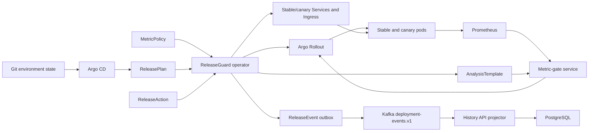
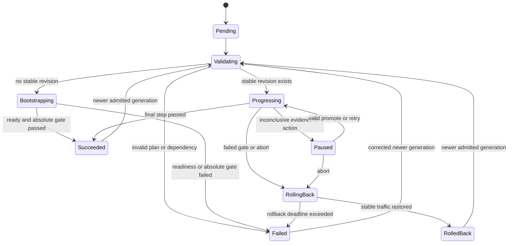

# ReleaseGuard v1 technical specification

| Field | Value |
|---|---|
| Status | Draft |
| Specification version | 0.1.0 |
| Target API version | `delivery.weihantu.dev/v1alpha1` |
| Last updated | 2026-08-29 |
| Implementation status | Week 2 in progress; not conformant with all v1 requirements |

This document is the normative specification for ReleaseGuard v1. The implementation roadmap and release-evidence policy live in [docs/PROJECT_PLAN.md](docs/PROJECT_PLAN.md).

## Contents

- [Foundations and system boundaries](#1-requirements-language): Sections 1–5
- [Kubernetes APIs and resource contracts](#6-kubernetes-api-overview): Sections 6–10
- [Reconciliation, rollout, gates, and events](#11-generated-resource-contract): Sections 11–16
- [External interfaces, security, and operation](#17-external-rest-api): Sections 17–22
- [Acceptance, verification, and versioning](#23-acceptance-scenarios): Sections 23–26

## 1. Requirements language

The words **MUST**, **MUST NOT**, **REQUIRED**, **SHALL**, **SHALL NOT**, **SHOULD**, **SHOULD NOT**, **RECOMMENDED**, **MAY**, and **OPTIONAL** describe requirement strength.

Requirement identifiers use the form `RG-<AREA>-<NNN>` and are stable references for tests, issues, ADRs, and implementation reviews.

## 2. Purpose

ReleaseGuard provides a constrained, GitOps-compatible deployment API for single-cluster Kubernetes services. It converts a long-lived `ReleasePlan` into Argo Rollouts resources, evaluates stable and canary metrics, controls promotion and rollback policy, and records an auditable deployment history.

ReleaseGuard is a control plane. It does not build application artifacts, implement a traffic proxy, collect metrics, or replace GitOps synchronization.

### 2.1 v1 outcomes

A conforming v1 implementation MUST:

1. Accept a versioned declarative release resource.
2. Validate unsafe or ambiguous plans before creating rollout children.
3. Reconcile idempotently after duplicate Kubernetes events and process restarts.
4. Progress a healthy release through declared traffic weights.
5. pause or roll back when metric evidence is missing or unhealthy.
6. Preserve an at-least-once, replayable deployment-event history.
7. Expose status, evidence, and audited operational actions through REST and a CLI.
8. Install on a clean Kind cluster and on the documented GKE reference environment.

### 2.2 Non-goals

ReleaseGuard v1 MUST NOT attempt to provide:

- CI job execution or artifact building;
- multi-region coordination;
- multi-cloud parity;
- arbitrary pipelines unrelated to Kubernetes deployment;
- a custom traffic router or service mesh;
- arbitrary developer-supplied PromQL;
- Spinnaker compatibility;
- Cassandra or Redis integration without a separate approved specification;
- a production-readiness or high-scale claim without published measurements.

## 3. System boundaries

### 3.1 Responsibilities

| Component | Owns | Does not own |
|---|---|---|
| Git repository | Reviewed desired `ReleasePlan` state | Live cluster status |
| Argo CD | Git-to-cluster synchronization and drift correction for Git-authored resources | Rollout policy decisions |
| ReleaseGuard operator | Validation, resource rendering, reconciliation, release phase, actions, durable outbox | Traffic proxy implementation |
| Argo Rollouts | ReplicaSets, traffic weights, pauses, aborts, and AnalysisRun lifecycle | ReleaseGuard DSL and audit projection |
| ingress-nginx | Weighted request routing in the v1 reference environment | Promotion decisions |
| Prometheus | Metric collection and query execution | Pass/fail policy |
| Metric-gate service | Evidence validation and deterministic gate decision | Traffic shifting |
| Kafka | Ordered per-release event transport and replay within retention | Desired deployment state |
| PostgreSQL | Rebuildable audit read model | Authoritative release state |
| History API | Status/evidence queries and creation of audited actions | Direct mutation of Git-managed specs |

### 3.2 Source-of-truth requirements

- `RG-SOT-001`: Git-authored `ReleasePlan` and `MetricPolicy` manifests MUST be treated as desired state.
- `RG-SOT-002`: Kubernetes resource status MUST be treated as authoritative observed control-plane state.
- `RG-SOT-003`: Kafka and PostgreSQL MUST be treated as derived audit state, never as rollout authority.
- `RG-SOT-004`: The REST API MUST NOT modify `ReleasePlan.spec` or `MetricPolicy.spec`.
- `RG-SOT-005`: Operational mutations MUST be represented by `ReleaseAction` resources.
- `RG-SOT-006`: Generated Argo, Service, and Ingress resources MUST be owned and reconciled by ReleaseGuard, not committed as Git-authored desired state.

## 4. Terminology and identity

| Term | Definition |
|---|---|
| Application | One long-lived `ReleasePlan` in one namespace |
| Release | One observed `ReleasePlan` generation |
| Release ID | `<ReleasePlan UID>:<generation>` |
| Stable revision | The last successfully promoted workload revision |
| Canary revision | The candidate workload revision receiving staged traffic |
| Step | One desired traffic weight plus an observation duration |
| Gate | One metric-policy evaluation attached to a step |
| Evidence | Canonical inputs, metric observations, timing metadata, and decision for one gate evaluation |
| Transition | A change in release phase, step, decision, or action outcome that requires an audit event |
| Outbox event | Internal `ReleaseEvent` resource awaiting or recording Kafka publication |

- `RG-ID-001`: Every release MUST be identified by Kubernetes UID and generation, not by mutable name alone.
- `RG-ID-002`: Every child resource MUST carry release plan name, UID, generation, and managed-by labels.
- `RG-ID-003`: Every trace, event, action, and evidence record MUST include the Release ID.

## 5. Logical architecture



## 6. Kubernetes API overview

All APIs use group `delivery.weihantu.dev` and version `v1alpha1`.

| Kind | Scope | Authorship | Purpose |
|---|---|---|---|
| `ReleasePlan` | Namespaced | Developer through Git | Long-lived workload and rollout desired state |
| `MetricPolicy` | Cluster | Platform administrator through Git | Approved metric query and comparison policy |
| `ReleaseAction` | Namespaced | Authenticated API/CLI or administrator | Audited pause, promote, abort, or retry request |
| `ReleaseEvent` | Namespaced | ReleaseGuard only | Durable Kafka outbox record |

All CRDs MUST expose structural OpenAPI schemas, status subresources, printer columns, and generated examples. `ReleasePlan` and `MetricPolicy` MUST be protected by validating admission logic in addition to schema validation.

## 7. ReleasePlan API

### 7.1 Lifecycle model

A `ReleasePlan` is long lived. Updating its pod template creates a new release identified by the new Kubernetes generation. The resource name identifies the application, not a specific version.

```yaml
apiVersion: delivery.weihantu.dev/v1alpha1
kind: ReleasePlan
metadata:
  name: checkout
  namespace: demo
spec:
  workload:
    replicas: 10
    managedContainer: app
    podTemplate:
      metadata:
        labels:
          app.kubernetes.io/name: checkout
      spec:
        containers:
          - name: app
            image: ghcr.io/weihantu/checkout@sha256:0123456789abcdef0123456789abcdef0123456789abcdef0123456789abcdef
            ports:
              - name: http
                containerPort: 8080
            resources:
              requests:
                cpu: 100m
                memory: 128Mi
              limits:
                cpu: 500m
                memory: 512Mi
  network:
    servicePort: 80
    targetPort: http
    ingress:
      className: nginx
      host: checkout.releaseguard.local
      path: /
  rollout:
    steps:
      - weight: 5
        duration: 2m
      - weight: 25
        duration: 5m
      - weight: 50
        duration: 5m
      - weight: 100
    gates:
      - policyRef: http-error-ratio
        maxCanaryValue: 0.01
        maxDeltaFromStable: 0.005
        consecutiveFailures: 3
        consecutiveSuccesses: 2
      - policyRef: request-p95-ms
        maxCanaryValue: 250
        maxDeltaFromStable: 50
        consecutiveFailures: 3
        consecutiveSuccesses: 2
  failurePolicy:
    metricUnavailable: Pause
    gateFailed: Rollback
    rollbackDeadline: 60s
    auditBackpressure: PausePromotion
  deletionPolicy: Delete
```

### 7.2 ReleasePlan spec

| Field | Type | Required | Semantics |
|---|---|---:|---|
| `workload.replicas` | integer | yes | Desired total replicas; minimum 2 in v1 |
| `workload.managedContainer` | string | yes | Container whose image identifies the release revision |
| `workload.podTemplate` | `PodTemplateSpec` | yes | Pod template rendered into the Argo Rollout |
| `network.servicePort` | integer | yes | Stable/canary Service port |
| `network.targetPort` | int-or-string | yes | Named or numeric pod port |
| `network.ingress.className` | string | yes | MUST be `nginx` in the v1 reference implementation |
| `network.ingress.host` | DNS name | yes | Host managed by the generated Ingress |
| `network.ingress.path` | string | yes | Prefix path; defaults to `/` |
| `rollout.steps` | array | yes | Strictly increasing traffic weights ending at 100 |
| `rollout.gates` | array | yes | Approved policies and developer-set bounded thresholds; at least one absolute gate must support bootstrap |
| `failurePolicy.metricUnavailable` | enum | yes | MUST be `Pause` in v1 |
| `failurePolicy.gateFailed` | enum | yes | MUST be `Rollback` in v1 |
| `failurePolicy.rollbackDeadline` | duration | yes | Time allowed to restore stable traffic |
| `failurePolicy.auditBackpressure` | enum | yes | MUST be `PausePromotion` in v1 |
| `deletionPolicy` | enum | no | `Delete` by default; `OrphanStable` optional |

### 7.3 Validation requirements

- `RG-PLAN-001`: The managed container MUST exist exactly once in the pod template.
- `RG-PLAN-002`: The managed container image MUST use an immutable `@sha256:<64 lowercase hex>` digest outside an explicitly configured local-development namespace.
- `RG-PLAN-003`: Every container image in the GKE reference environment MUST use a digest.
- `RG-PLAN-004`: Replica count MUST be between the configured minimum and maximum; the default v1 range is 2 through 100.
- `RG-PLAN-005`: Traffic weights MUST be integers in `[1,100]`, strictly increase, and end at 100.
- `RG-PLAN-006`: Each nonterminal step MUST define a duration between 10 seconds and 24 hours.
- `RG-PLAN-007`: Every referenced `MetricPolicy` MUST exist, be accepted, and permit the supplied threshold fields.
- `RG-PLAN-008`: Raw PromQL MUST NOT appear in a `ReleasePlan`.
- `RG-PLAN-009`: Workload selectors and generated service selectors MUST be derived from immutable ReleaseGuard labels, not trusted user labels.
- `RG-PLAN-010`: Privileged containers, host networking, host PID/IPC, host paths, and added Linux capabilities MUST be rejected by default.
- `RG-PLAN-011`: A spec update that changes rollout-affecting fields while the current generation is active MUST be rejected by the admission webhook in v1.
- `RG-PLAN-012`: Metadata-only changes MAY be admitted while a rollout is active if they cannot change generated children.
- `RG-PLAN-013`: A plan with no stable revision MUST be treated as a bootstrap release and MUST NOT claim baseline comparison.

### 7.4 ReleasePlan status

```yaml
status:
  observedGeneration: 4
  releaseId: "4f8f...:4"
  phase: Progressing
  currentStep: 1
  stableRevision: checkout-7b8d9
  canaryRevision: checkout-1ac42
  rolloutRef:
    name: checkout
  lastGateDecision:
    decision: Pass
    evidenceRef: evidence-4-1-http-errors
    observedAt: "2026-08-26T21:00:00Z"
  lastTransition:
    sequence: 12
    eventId: "sha256:..."
    type: rollout.step.passed
    occurredAt: "2026-08-26T21:00:01Z"
  pendingOutboxEvents: 0
  conditions: []
```

Allowed phases:

- `Pending`
- `Validating`
- `Bootstrapping`
- `Progressing`
- `Paused`
- `RollingBack`
- `Succeeded`
- `RolledBack`
- `Failed`
- `Deleting`

- `RG-STAT-001`: Status MUST record `observedGeneration`.
- `RG-STAT-002`: Conditions MUST use Kubernetes condition conventions and include `Ready`, `Progressing`, `GateHealthy`, `AuditHealthy`, and `Degraded` where applicable.
- `RG-STAT-003`: Human-readable messages MUST NOT be parsed to drive control behavior; machine-readable reason codes are required.
- `RG-STAT-004`: A new admitted generation MAY transition a previously terminal plan back to `Validating`.
- `RG-STAT-005`: Argo phase, step, and revision evidence MUST be projected only from a Rollout status whose `observedGeneration` covers the current Rollout generation.
- `RG-STAT-006`: Child status alone MUST NOT claim a ReleaseGuard-approved promotion or rollback; those phase transitions require the corresponding gate or action decision.

## 8. MetricPolicy API

`MetricPolicy` is cluster-scoped and writable only by platform administrators.

```yaml
apiVersion: delivery.weihantu.dev/v1alpha1
kind: MetricPolicy
metadata:
  name: http-error-ratio
spec:
  direction: LowerIsBetter
  unit: ratio
  valueQueryTemplate: |
    sum(rate(http_server_requests_seconds_count{release_revision="{{revision}}",status=~"5.."}[{{window}}]))
    /
    sum(rate(http_server_requests_seconds_count{release_revision="{{revision}}"}[{{window}}]))
  sampleCountQueryTemplate: |
    sum(increase(http_server_requests_seconds_count{release_revision="{{revision}}"}[{{window}}]))
  allowedThresholds:
    canary:
      minimum: 0
      maximum: 0.10
    stableDelta:
      minimum: 0
      maximum: 0.05
  minimumSamples: 100
  window: 2m
  interval: 20s
  timeout: 5s
status:
  observedGeneration: 1
  accepted: true
```

- `RG-POL-001`: Query templates MUST be administrator-authored and MUST accept only allowlisted, correctly escaped substitutions.
- `RG-POL-002`: The v1 substitution set MUST be limited to revision label, namespace, release name, and validated duration window.
- `RG-POL-003`: Policies MUST declare `LowerIsBetter` or `HigherIsBetter`.
- `RG-POL-004`: Policies MUST define value and sample-count queries, minimum samples, window, interval, and provider timeout.
- `RG-POL-005`: Policy status MUST report schema validation and a dry-run query result against the configured Prometheus server before the policy is accepted, and `accepted` MUST apply only when `status.observedGeneration` equals `metadata.generation`.
- `RG-POL-006`: Developer thresholds outside administrator bounds MUST be rejected.
- `RG-POL-007`: Policy changes MUST NOT alter an already-running AnalysisRun; the operator MUST snapshot the accepted policy version into generated resources.

## 9. ReleaseAction API

```yaml
apiVersion: delivery.weihantu.dev/v1alpha1
kind: ReleaseAction
metadata:
  generateName: checkout-abort-
  namespace: demo
spec:
  target:
    name: checkout
    uid: 4f8f...
    generation: 4
  type: Abort
  reason: "Error budget exhausted during incident INC-42"
  idempotencyKey: "7cc18a92-..."
  actor: "operator@example.com"
  requestedAt: "2026-08-26T21:00:00Z"
```

Supported action types:

| Type | Valid source phases | Result |
|---|---|---|
| `Pause` | `Bootstrapping`, `Progressing` | Stops further promotion |
| `Promote` | `Paused` | Continues only when the last required gate passed |
| `Abort` | Any nonterminal phase | Initiates rollback or stops bootstrap |
| `RetryAnalysis` | `Paused` | Re-runs the current step without changing traffic weight |

- `RG-ACT-001`: An action MUST target exact name, UID, and generation.
- `RG-ACT-002`: Stale actions MUST be rejected without changing rollout state.
- `RG-ACT-003`: Every action MUST contain an authenticated actor, nonempty reason, creation time, and idempotency key before execution.
- `RG-ACT-004`: Reusing an idempotency key with the same request MUST return the original result; reusing it with different content MUST fail.
- `RG-ACT-005`: `Promote` MUST NOT bypass a failed or inconclusive gate in v1.
- `RG-ACT-006`: `Abort` and safety rollback MUST remain available when Kafka, PostgreSQL, or the history API is unavailable.
- `RG-ACT-007`: Completed actions MUST be immutable and retained according to the audit-retention policy.

## 10. ReleaseEvent durable outbox

`ReleaseEvent` is an internal resource. Developer and general service identities MUST NOT create, update, or delete it.

```yaml
apiVersion: delivery.weihantu.dev/v1alpha1
kind: ReleaseEvent
metadata:
  name: checkout-4-000012
  namespace: demo
spec:
  eventId: "sha256:..."
  releaseId: "4f8f...:4"
  sequence: 12
  type: rollout.step.passed
  occurredAt: "2026-08-26T21:00:01Z"
  payload: {}
status:
  phase: Published
  attempts: 1
  kafka:
    topic: deployment-events.v1
    partition: 4
    offset: 9182
  publishedAt: "2026-08-26T21:00:02Z"
```

- `RG-OUT-001`: A transition event MUST have a deterministic event ID and outbox name.
- `RG-OUT-002`: ReleasePlan status MUST retain enough `lastTransition` data to recreate a missing deterministic outbox resource after a crash.
- `RG-OUT-003`: The event publisher MUST use release UID as the Kafka record key.
- `RG-OUT-004`: The Kafka producer MUST enable idempotence and acknowledgments from all in-sync replicas in the cloud reference configuration.
- `RG-OUT-005`: A crash after Kafka acknowledgment but before outbox-status update MAY produce a duplicate; consumers MUST deduplicate by event ID.
- `RG-OUT-006`: Pending outbox events MUST never be deleted by TTL or cleanup.
- `RG-OUT-007`: Published outbox events MUST be retained for at least seven days by default.
- `RG-OUT-008`: When pending events exceed the configured bound or oldest-pending age, new promotions MUST pause. Abort and rollback MUST remain allowed.
- `RG-OUT-009`: Publication attempts MUST use exponential backoff with jitter and expose attempt count and next-attempt time.

## 11. Generated resource contract

For `ReleasePlan/demo/checkout`, ReleaseGuard generates deterministic names:

```text
Rollout:          checkout
Service stable:   checkout-stable
Service canary:   checkout-canary
Ingress:          checkout
AnalysisTemplate: checkout-gates-g<generation>
```

- `RG-RES-001`: Namespaced generated resources MUST use owner references to the `ReleasePlan` unless `deletionPolicy=OrphanStable` is being finalized.
- `RG-RES-002`: The operator MUST use server-side apply with field manager `releaseguard-operator`.
- `RG-RES-003`: The operator MUST manage only documented fields and MUST report field-manager conflicts rather than force ownership silently.
- `RG-RES-004`: User edits to operator-owned fields MUST be reverted on reconciliation and recorded as drift metrics.
- `RG-RES-005`: Rollout revision labels MUST distinguish stable and canary metrics without relying on pod names.
- `RG-RES-006`: The generated Ingress MUST use Argo Rollouts-compatible ingress-nginx traffic annotations.
- `RG-RES-007`: Generated Services MUST use generation-stable ReleaseGuard identity selectors. ReleaseGuard initializes those selectors, Argo Rollouts owns the pod-template-hash routing selector after adoption, and ReleaseGuard MUST verify the resulting selector before safety decisions.
- `RG-RES-008`: Generated AnalysisTemplates MUST snapshot policy queries, thresholds, timing, and policy resource version for the release generation.

## 12. Reconciliation specification

### 12.1 Reconcile sequence

For every `ReleasePlan` event, the operator MUST execute these logical steps:

1. Load the latest ReleasePlan and its status.
2. Stop if deletion handling is required.
3. Validate schema-derived and semantic invariants.
4. Resolve and validate all referenced MetricPolicies.
5. Determine whether the generation is bootstrap, new release, active release, or already converged.
6. Render the complete desired child-resource set in memory.
7. Apply children using deterministic names and server-side apply.
8. Observe Argo Rollout and AnalysisRun state.
9. Calculate the next ReleaseGuard phase and step.
10. Persist status using optimistic concurrency.
11. Ensure the deterministic ReleaseEvent exists for any recorded transition.
12. Requeue only when required by a deadline, retry, or external observation.

### 12.2 Core reconciliation requirements

- `RG-REC-001`: Repeating reconciliation against unchanged input MUST converge without semantic child-resource changes.
- `RG-REC-002`: The reconciler MUST tolerate duplicate, delayed, and reordered watch events.
- `RG-REC-003`: Status conflicts MUST cause a fresh read and recomputation; stale calculated state MUST NOT be blindly retried.
- `RG-REC-004`: External calls MUST have deadlines, bounded retries, exponential backoff, and cancellation on shutdown.
- `RG-REC-005`: Validation failure MUST create no rollout-affecting children and MUST set `Failed` with a machine-readable reason.
- `RG-REC-006`: A dependency outage MUST NOT be represented as a successful or healthy release.
- `RG-REC-007`: Operator replicas MUST be safe under active-active duplicate reconciliation or protected by Kubernetes Lease leadership. The selected model MUST have an ADR and a multi-replica test.
- `RG-REC-008`: Shutdown MUST stop accepting new work, complete or cancel bounded in-flight work, and release leadership cleanly.
- `RG-REC-009`: The operator MUST NOT use local memory as the only record of phase, step, retry, or action completion.

### 12.3 Bootstrap behavior

The first accepted generation has no stable baseline.

- `RG-BOOT-001`: The first generation MUST be labeled and audited as `Bootstrapping`, not canary analyzed against a nonexistent stable revision.
- `RG-BOOT-002`: Bootstrap MUST require pod readiness and at least one administrator-approved absolute metric gate before becoming stable.
- `RG-BOOT-003`: A failed bootstrap readiness or absolute gate MUST stop candidate traffic and enter `Failed`; it MUST NOT claim rollback.
- `RG-BOOT-004`: Successful bootstrap MUST record the first stable revision and emit `release.bootstrapped`.

### 12.4 Deletion and finalizers

- `RG-DEL-001`: The finalizer MUST use a configurable deadline and MUST surface cleanup failure.
- `RG-DEL-002`: `Delete` MUST abort active rollout, remove generated children, then remove the finalizer.
- `RG-DEL-003`: `OrphanStable` MUST restore stable traffic; retain a ready stable ReplicaSet, Service, and Ingress without ReleaseGuard or Rollout ownership; remove the Rollout plus canary and analysis children; emit an event; then remove the finalizer.
- `RG-DEL-004`: The operator MUST NOT leave traffic intentionally routed to a canary after finalization.

## 13. Release state machine

State is evaluated per Release ID. A newer admitted generation starts a new release after the prior generation is terminal.



- `RG-FSM-001`: Transitions not shown above MUST be rejected and recorded as controller errors.
- `RG-FSM-002`: Phase transitions MUST be monotonic within one generation except `Paused -> Progressing`.
- `RG-FSM-003`: Rollback success MUST require observed stable traffic restoration, not merely an accepted abort API call.
- `RG-FSM-004`: `Succeeded` MUST require the final traffic step, all required gates, workload availability, and no blocking audit backpressure.

## 14. Progressive-delivery behavior

### 14.1 Step execution

- `RG-ROLL-001`: The operator MUST render traffic weights and pauses into Argo Rollouts rather than implementing request routing itself.
- `RG-ROLL-002`: The reference traffic provider for v1 MUST be ingress-nginx.
- `RG-ROLL-003`: A step observation duration MUST begin only after the requested traffic weight and minimum canary availability are observed.
- `RG-ROLL-004`: Gate intervals and success/failure counts MUST fit inside the configured step duration; invalid combinations MUST be rejected.
- `RG-ROLL-005`: No release may advance more than one declared step per successful gate sequence.
- `RG-ROLL-006`: A paused rollout MUST retain stable serving capacity sufficient for immediate restoration.
- `RG-ROLL-007`: A rollout MUST NOT automatically promote while any required gate is `Fail` or `Inconclusive`.
- `RG-ROLL-008`: Weights below 100 are observed canary steps. Weight 100 is the terminal promotion step and MUST occur only after all preceding required gates pass.

### 14.2 Rollback

- `RG-RBK-001`: A failed required gate MUST initiate Argo abort within the configured control-loop deadline.
- `RG-RBK-002`: Rollback is complete only when canary traffic is zero and the stable Service has ready endpoints.
- `RG-RBK-003`: The rollback deadline MUST be measured from the first accepted rollback transition.
- `RG-RBK-004`: Deadline expiry MUST enter `Failed`, preserve evidence, and emit an alert-worthy condition.
- `RG-RBK-005`: A rollback MUST NOT delete evidence or event history for the failed candidate.

## 15. Metric-gate service

### 15.1 Internal API

The Argo analysis integration calls:

```text
POST /internal/v1/evaluations
Content-Type: application/json
```

Request fields:

```json
{
  "releaseId": "4f8f...:4",
  "step": 1,
  "mode": "Canary",
  "policy": {},
  "stableRevision": "checkout-7b8d9",
  "canaryRevision": "checkout-1ac42",
  "thresholds": {},
  "evaluationTime": "2026-08-26T21:00:00Z"
}
```

Response fields:

```json
{
  "decision": "Pass",
  "reason": "WithinAbsoluteAndBaselineLimits",
  "stableValue": 0.002,
  "canaryValue": 0.004,
  "stableSamples": 1200,
  "canarySamples": 180,
  "windowStart": "2026-08-26T20:58:00Z",
  "windowEnd": "2026-08-26T21:00:00Z",
  "policyResourceVersion": "817263",
  "evidenceDigest": "sha256:..."
}
```

### 15.2 Decision algorithm

The gate service SHOULD be stateless. Argo AnalysisRun configuration owns consecutive success and failure counting.

For `LowerIsBetter` in canary mode:

```text
absolutePass = canaryValue <= maxCanaryValue
baselinePass = canaryValue - stableValue <= maxDeltaFromStable
pass = enoughSamples AND absolutePass AND baselinePass
```

For `HigherIsBetter` in canary mode:

```text
absolutePass = canaryValue >= minCanaryValue
baselinePass = stableValue - canaryValue <= maxDeltaFromStable
pass = enoughSamples AND absolutePass AND baselinePass
```

If a bound is not configured, its predicate is omitted rather than implicitly passed.

In bootstrap mode, `stableRevision` is absent, the baseline predicate is recorded as `NotApplicable`, and only the sample requirement and administrator-approved absolute predicate are evaluated. A policy with no absolute predicate is invalid for bootstrap; a configured baseline delta is retained for later generations but ignored during bootstrap.

- `RG-GATE-001`: A valid evaluation MUST use separate stable and canary revision labels.
- `RG-GATE-002`: Insufficient samples, empty vectors, multiple unexpected series, NaN, infinity, stale results, timeouts, provider errors, or malformed responses MUST return `Inconclusive`.
- `RG-GATE-003`: `Inconclusive` MUST never be translated to success.
- `RG-GATE-004`: A completed threshold breach MUST return `Fail`, not `Inconclusive`.
- `RG-GATE-005`: Queries MUST be bounded by policy timeout and overall request deadline.
- `RG-GATE-006`: The same canonical request and Prometheus observations MUST yield the same decision and digest.
- `RG-GATE-007`: Evidence digest MUST be SHA-256 over canonical JSON containing request, query metadata, raw normalized observations, and decision.
- `RG-GATE-008`: The service MUST redact credentials and authorization headers from evidence and logs.
- `RG-GATE-009`: Gate responses MUST include machine-readable reason codes.
- `RG-GATE-010`: Prometheus unavailability MUST pause the rollout after the configured AnalysisRun inconclusive limit; it MUST NOT promote or automatically roll back solely because monitoring disappeared.
- `RG-GATE-011`: Bootstrap mode MUST evaluate at least one absolute gate and MUST NOT fabricate or reuse a stable baseline.

## 16. Event and audit specification

### 16.1 Kafka topic

The v1 topic name is `deployment-events.v1`.

- Records MUST be keyed by release UID.
- Topic partition count and replication factor are environment configuration.
- The cloud reference configuration MUST use at least three brokers and replication factor three if budget and managed environment permit; otherwise it MUST be explicitly labeled non-HA.
- The topic MUST retain ordered history and MUST NOT use log compaction as the only retention policy.

### 16.2 Event envelope

```json
{
  "schemaVersion": 1,
  "eventId": "sha256:...",
  "type": "rollout.step.passed",
  "releaseId": "4f8f...:4",
  "releaseUid": "4f8f...",
  "generation": 4,
  "sequence": 12,
  "namespace": "demo",
  "releaseName": "checkout",
  "gitRevision": "abc123",
  "imageDigest": "sha256:...",
  "occurredAt": "2026-08-26T21:00:01Z",
  "traceId": "...",
  "payload": {}
}
```

Required event types:

- `release.accepted`
- `release.validation_failed`
- `release.bootstrapped`
- `rollout.started`
- `rollout.step.started`
- `gate.evaluated`
- `rollout.paused`
- `rollout.promoted`
- `rollback.started`
- `rollback.completed`
- `release.succeeded`
- `release.failed`
- `action.accepted`
- `action.rejected`

- `RG-EVT-001`: Sequence numbers MUST increase monotonically per Release ID.
- `RG-EVT-002`: Consumers MUST NOT assume global ordering across releases.
- `RG-EVT-003`: Unknown additive payload fields MUST be ignored.
- `RG-EVT-004`: Breaking schema changes require a new schema version and compatibility plan.
- `RG-EVT-005`: Event timestamps MUST use UTC RFC 3339 with subsecond precision.
- `RG-EVT-006`: Evidence references MUST include a content digest.

### 16.3 PostgreSQL projection

- `RG-AUD-001`: `event_id` MUST be a primary or unique key.
- `RG-AUD-002`: Event insertion and projection update MUST occur in one PostgreSQL transaction.
- `RG-AUD-003`: Reprocessing an existing event MUST be a successful no-op.
- `RG-AUD-004`: A state-regressing event with a new ID MUST be quarantined and counted rather than silently applied.
- `RG-AUD-005`: Deleting and rebuilding the projection from retained Kafka events MUST yield equivalent release and event views.
- `RG-AUD-006`: Query responses MUST report projection freshness, including last Kafka offsets and projected-through time.

## 17. External REST API

All externally accessible endpoints are versioned under `/v1`. JSON is the required representation for v1.

### 17.1 Endpoints

| Method and path | Purpose | Source |
|---|---|---|
| `POST /v1/plans:validate` | Validate a plan without cluster mutation | Live CRD and policy rules |
| `POST /v1/plans:render` | Return redacted generated resources without applying them | Operator renderer |
| `GET /v1/releases/{namespace}/{name}` | Current release and projection freshness | PostgreSQL plus live status link |
| `GET /v1/releases/{namespace}/{name}/events` | Paginated audit history | PostgreSQL |
| `GET /v1/releases/{namespace}/{name}/evidence` | Gate evidence metadata and digests | PostgreSQL/evidence store |
| `POST /v1/releases/{namespace}/{name}:pause` | Create a Pause action | Kubernetes API |
| `POST /v1/releases/{namespace}/{name}:promote` | Create a Promote action | Kubernetes API |
| `POST /v1/releases/{namespace}/{name}:abort` | Create an Abort action | Kubernetes API |
| `POST /v1/releases/{namespace}/{name}:retryAnalysis` | Create a RetryAnalysis action | Kubernetes API |
| `GET /livez` | Process liveness | Local process state |
| `GET /readyz` | Readiness for serving API traffic | Required internal dependencies |
| `GET /actuator/prometheus` | Prometheus metrics | Micrometer |

### 17.2 API requirements

- `RG-HTTP-001`: An OpenAPI document MUST define all external endpoints and error schemas.
- `RG-HTTP-002`: Mutating requests MUST require `Idempotency-Key` and authenticated identity.
- `RG-HTTP-003`: Request bodies MUST have explicit size limits.
- `RG-HTTP-004`: List endpoints MUST use bounded cursor pagination and deterministic ordering.
- `RG-HTTP-005`: Errors MUST contain stable code, human-readable message, trace ID, and field violations where applicable.
- `RG-HTTP-006`: `404` MUST distinguish unknown release from an unavailable or stale projection.
- `RG-HTTP-007`: API responses from derived state MUST expose freshness metadata.
- `RG-HTTP-008`: `/livez` MUST NOT fail because an external dependency is unavailable.
- `RG-HTTP-009`: `/readyz` MAY fail when the service cannot safely fulfill its API contract, but liveness MUST remain healthy to avoid restart cascades.
- `RG-HTTP-010`: Internal evaluation endpoints MUST use cluster-internal authentication and MUST NOT be exposed publicly.

## 18. CLI contract

The CLI executable name is `releaseguard`.

Required commands:

```text
releaseguard plan validate -f release-plan.yaml
releaseguard plan render -f release-plan.yaml
releaseguard release status demo/checkout
releaseguard release events demo/checkout
releaseguard release evidence demo/checkout
releaseguard release pause demo/checkout --reason "..."
releaseguard release promote demo/checkout --reason "..."
releaseguard release abort demo/checkout --reason "..."
releaseguard release retry-analysis demo/checkout --reason "..."
```

- `RG-CLI-001`: Read-only commands MUST support human-readable and JSON output.
- `RG-CLI-002`: Mutation commands MUST display the exact target UID and generation before submission.
- `RG-CLI-003`: Noninteractive mutation MUST require explicit target generation.
- `RG-CLI-004`: The CLI MUST return nonzero status for validation failure, rejected action, timeout, stale projection when freshness is required, or transport failure.
- `RG-CLI-005`: The CLI MUST NOT write credentials into repository files or shell history through generated commands.

## 19. Security specification

### 19.1 Identity and authorization

- `RG-SEC-001`: The cloud reference environment MUST authenticate human API requests using OIDC-issued identity.
- `RG-SEC-002`: Authorization MUST distinguish viewer, developer-operator, and platform-administrator capabilities.
- `RG-SEC-003`: Only platform administrators may create or modify `MetricPolicy`.
- `RG-SEC-004`: Developers may create actions only for authorized namespaces and applications.
- `RG-SEC-005`: ReleaseGuard service accounts MUST use least-privilege RBAC and separate identities per component.
- `RG-SEC-006`: Namespaced watches are the default. Cluster-wide plan reconciliation requires explicit configuration and documentation.

### 19.2 Workload and container security

- `RG-SEC-007`: ReleaseGuard containers MUST run as non-root with a read-only root filesystem, seccomp default, and all Linux capabilities dropped unless an exception is documented.
- `RG-SEC-008`: Every container MUST define CPU and memory requests and limits in the reference Helm values.
- `RG-SEC-009`: Secrets MUST be mounted or obtained from the runtime secret mechanism and MUST NOT appear in CRD status, Kafka events, evidence, logs, images, or Git.
- `RG-SEC-010`: Kubernetes NetworkPolicies MUST restrict component ingress and egress in the GKE reference environment.
- `RG-SEC-011`: TLS MUST protect externally accessible APIs and authenticated internal traffic where the environment supports it.

### 19.3 Supply chain

- `RG-SEC-012`: Pull requests MUST scan Java dependencies, container images, IaC, and committed content for vulnerabilities and secrets.
- `RG-SEC-013`: Releases MUST publish SBOMs and signed image provenance.
- `RG-SEC-014`: Release environments MUST deploy image digests, not mutable tags.
- `RG-SEC-015`: Critical findings require remediation or a documented, expiring exception before release.

## 20. Observability specification

### 20.1 Required metrics

Operator:

```text
releaseguard_reconcile_total{controller,result,reason}
releaseguard_reconcile_duration_seconds{controller,result}
releaseguard_queue_depth{controller}
releaseguard_queue_oldest_age_seconds{controller}
releaseguard_release_phase{namespace,name,phase}
releaseguard_rollout_transition_total{from,to,reason}
releaseguard_kubernetes_api_request_duration_seconds{verb,resource,result}
releaseguard_outbox_pending{namespace}
releaseguard_outbox_oldest_age_seconds{namespace}
```

Metric-gate service:

```text
releaseguard_gate_evaluation_total{policy,decision,reason}
releaseguard_gate_evaluation_duration_seconds{policy,decision}
releaseguard_prometheus_query_duration_seconds{policy,result}
releaseguard_gate_samples{policy,revision_role}
releaseguard_gate_breach_to_rollback_seconds{policy}
```

History API:

```text
releaseguard_kafka_consumer_lag{topic,partition}
releaseguard_event_projection_total{type,result}
releaseguard_event_duplicate_total{type}
releaseguard_projection_latency_seconds{type}
releaseguard_projection_quarantine_total{reason}
```

- `RG-OBS-001`: Metrics MUST avoid unbounded labels such as release UID, image digest, trace ID, or user identity.
- `RG-OBS-002`: Logs MUST be structured and include trace ID, release ID, controller, reason code, and safe resource identity when applicable.
- `RG-OBS-003`: Logs MUST NOT be the only source of release state or evidence.
- `RG-OBS-004`: OpenTelemetry context SHOULD propagate through HTTP and Kafka; Kubernetes reconciliation MUST create or link spans using Release ID.
- `RG-OBS-005`: Dashboards MUST separate control-plane health, rollout safety, gate health, and audit-pipeline health.

### 20.2 Provisional SLOs

These are acceptance targets, not achieved results:

| SLI | Target under published reference load |
|---|---|
| Valid plan change to first reconciliation | 99% within 10 seconds |
| Accepted transition to Kafka publish | 99% within 10 seconds when Kafka is healthy |
| Kafka publish to audit query visibility | 99% within 15 seconds when PostgreSQL is healthy |
| Confirmed gate failure to rollback initiation | 99% within 15 seconds |
| Promotion while required metrics are unavailable | Exactly zero |

- `RG-SLO-001`: Every SLO result MUST identify environment, duration, load, exclusions, and sample count.
- `RG-SLO-002`: A Kind result MUST NOT be relabeled as cloud or production behavior.

## 21. Configuration and packaging

### 21.1 Helm

The `releaseguard` chart MUST install:

- operator and admission webhook;
- metric-gate service;
- history API and projector;
- CRDs and RBAC;
- Services, configuration, ServiceMonitors where available, and NetworkPolicies;
- optional development dependencies only when explicitly enabled.

Argo CD, Argo Rollouts, ingress-nginx, Prometheus, Kafka, and PostgreSQL MAY be chart dependencies for a local profile but SHOULD be independently managed in the GKE reference profile.

- `RG-PKG-001`: `helm install` on a clean supported cluster MUST reach Ready without manual manifest edits.
- `RG-PKG-002`: Helm values MUST distinguish local insecure defaults from cloud-safe configuration.
- `RG-PKG-003`: CRD upgrades MUST be documented and MUST NOT rely on Helm silently deleting data-bearing CRDs.
- `RG-PKG-004`: All images and chart dependencies MUST be pinned for release evidence.

### 21.2 Kind

- `RG-KIND-001`: One command MUST create the documented local cluster and install required dependencies.
- `RG-KIND-002`: One bounded command MUST run the critical healthy, faulty, missing-metric, and restart scenarios.
- `RG-KIND-003`: Teardown MUST remove only the explicitly named ReleaseGuard cluster and local runtime data.

### 21.3 GKE and Terraform

- `RG-GKE-001`: Terraform MUST provision and destroy the complete documented GKE reference environment.
- `RG-GKE-002`: Terraform state MUST remain outside Git.
- `RG-GKE-003`: Cloud identity MUST use short-lived federation where practical; static service-account keys MUST NOT be committed or embedded.
- `RG-GKE-004`: Resources MUST carry project labels for ownership and cost reporting.
- `RG-GKE-005`: The cloud test workflow MUST implement bounded timeout and teardown even after test failure.

## 22. Failure behavior

| Condition | Required behavior | Promotion allowed? |
|---|---|---:|
| Invalid plan | Set `Failed`; create no rollout-affecting children | No |
| Missing MetricPolicy | Set `Failed` before rollout | No |
| Prometheus timeout/error | Gate `Inconclusive`; pause after configured limit | No |
| Insufficient samples | Gate `Inconclusive`; remain at current weight | No |
| Gate threshold breach | Gate `Fail`; initiate rollback | No |
| Argo Rollouts unavailable | Set dependency condition; retry with backoff | No |
| Kubernetes API conflict | Fresh read and recompute | No new transition until resolved |
| Kafka unavailable below outbox bound | Retry publication; rollout safety continues | Yes, subject to audit policy |
| Kafka unavailable above bound | Pause new promotions; preserve abort/rollback | No |
| PostgreSQL unavailable | Accumulate Kafka lag; history API reports unavailable/stale | Yes |
| Operator restart | Resume from Kubernetes state | Only after reconvergence |
| Stale action | Reject and audit | No effect |
| Rollback deadline exceeded | Enter `Failed`; alert; retain evidence | No |

- `RG-FAIL-001`: Fail-safe behavior MUST prioritize halting promotion over availability when release health cannot be established.
- `RG-FAIL-002`: Audit-system failure MUST never block abort or rollback.
- `RG-FAIL-003`: Dependency recovery MUST be automatic where retry is safe and bounded.
- `RG-FAIL-004`: Every table row above MUST have an automated test or a documented cloud failure drill before v1 release.

## 23. Acceptance scenarios

### AC-001: Clean installation

Given a clean supported Kind cluster, the documented bootstrap command installs ReleaseGuard and dependencies, all readiness checks pass, and no manual patch is required.

### AC-002: Bootstrap release

Given a valid first-generation plan, ReleaseGuard deploys it as bootstrap, requires readiness and an approved absolute metric gate, records the first stable revision, and does not claim stable-versus-canary analysis.

### AC-003: Healthy progressive release

Given a stable application and a healthy new digest, ReleaseGuard advances through 5, 25, 50, and 100 percent traffic only after the required evidence and finishes `Succeeded` without manual intervention.

### AC-004: Faulty canary rollback

Given a canary configured to return 20% HTTP 5xx, the error gate fails, promotion stops before the next step, stable traffic is restored, and the release finishes `RolledBack` with complete evidence.

### AC-005: Missing metrics

Given Prometheus is unavailable during a step, evaluation becomes `Inconclusive`, traffic remains at the current weight, and no automatic promotion occurs.

### AC-006: Operator restart

Given the operator is terminated between status transition and outbox creation, a replacement reconciler recreates the same deterministic event, resumes the same generation, and creates no duplicate semantic transition.

### AC-007: Kafka outage and recovery

Given Kafka is unavailable, outbox events remain pending and are published after recovery. If the configured pending bound is exceeded, promotion pauses while abort remains functional.

### AC-008: Duplicate delivery

Given the same Kafka event is delivered repeatedly, PostgreSQL contains one event and the release projection remains unchanged after the first application.

### AC-009: Projection rebuild

Given an empty audit database and retained Kafka history, replay reconstructs a projection equivalent to the pre-deletion snapshot.

### AC-010: Git and child drift

Given an unauthorized plan change, Argo CD restores Git state. Given an unauthorized operator-child change, ReleaseGuard restores its owned fields and reports drift.

### AC-011: Stale action

Given an Abort action targets an older UID or generation, ReleaseGuard rejects it and does not affect the active release.

### AC-012: Rollback failure

Given stable endpoints cannot become ready before the rollback deadline, ReleaseGuard enters `Failed`, stops promotion, retains evidence, and exposes an alerting condition and runbook link.

### AC-013: Control-plane saturation test

Given increasing concurrent ReleasePlans beginning at 25 and doubling, the benchmark identifies a repeatable saturation point and publishes p50, p95, and p99 convergence, Kubernetes throttling, queue age, CPU, memory, and failure counts without labeling synthetic results as live workload scale.

## 24. Required verification mapping

| Area | Minimum verification |
|---|---|
| CRD and validation | Schema tests, webhook tests, invalid corpus |
| Reconciliation | Unit tests, property tests, Fabric8 integration, Kind restart tests |
| Generated resources | Golden tests, server-side apply test, drift test |
| Gate decisions | Table-driven edge cases, fake Prometheus integration, deterministic digest test |
| Actions | Authorization, idempotency, stale-target, phase-transition tests |
| Outbox and Kafka | Crash-window, outage, duplicate, ordering, and retry tests |
| Projection | Transaction, deduplication, quarantine, and full replay tests |
| REST and CLI | OpenAPI contract, pagination, errors, idempotency, JSON output tests |
| Security | RBAC, container policy, secret scan, dependency/image/IaC scans |
| Packaging | Clean Kind install and Terraform validation |
| Operations | Failure drills, dashboards, alerts, runbooks, and postmortem |

## 25. Compatibility and versioning

- `RG-VER-001`: `v1alpha1` may evolve incompatibly before the first stable API, but every change MUST include conversion or migration instructions for committed examples and stored resources.
- `RG-VER-002`: Event schema compatibility MUST be tested independently from CRD compatibility.
- `RG-VER-003`: Stored API upgrade tests MUST cover at least the immediately previous released version after the first tagged release.
- `RG-VER-004`: Supported Kubernetes, Argo CD, Argo Rollouts, ingress-nginx, Kafka, PostgreSQL, and Java versions MUST be pinned in a compatibility matrix before implementation evidence is published.
- `RG-VER-005`: Generated CRDs and OpenAPI documents MUST be reproducible and checked for freshness in CI.

## 26. Definition of v1 conformance

An implementation conforms to this specification only when:

1. All MUST and MUST NOT requirements are implemented or explicitly removed through a reviewed specification change.
2. Acceptance scenarios AC-001 through AC-012 pass automatically or, where cloud credentials are required, through a reproducible recorded workflow.
3. AC-013 publishes actual saturation evidence without a predetermined success number.
4. Critical security scans and clean-install gates pass.
5. The README distinguishes planned, implemented, integrated, measured, and deferred functionality.
6. The implementation and evidence are traceable to stable requirement IDs in this document.

Until then, ReleaseGuard remains an implementation in progress and MUST NOT be described as a production deployment platform.
